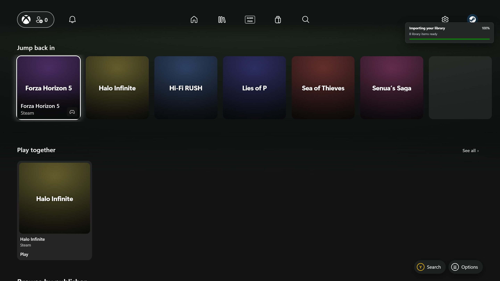
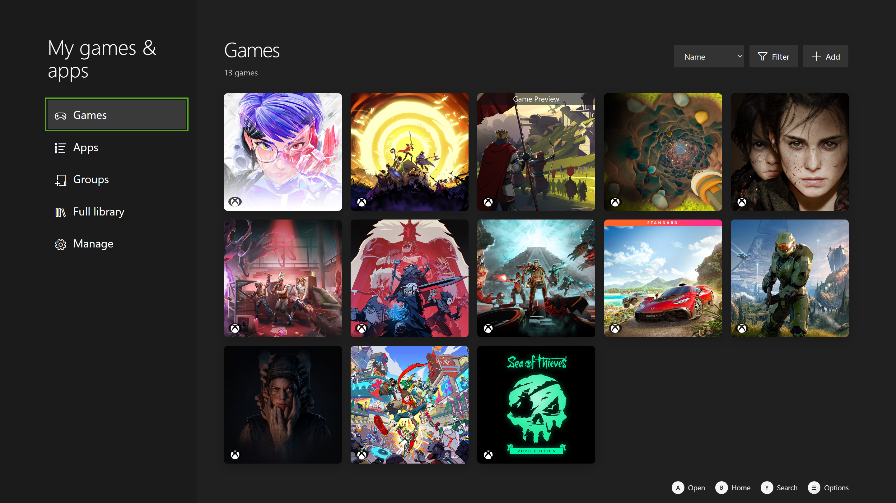
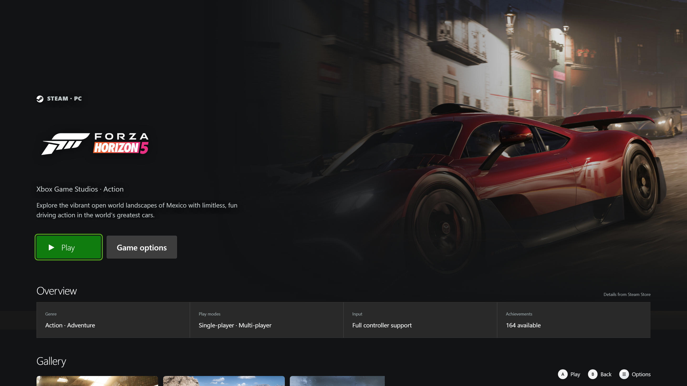

# Xbox Preview UI

An unofficial, controller-first launcher for your Windows games. It brings a console-style Home screen, a proper game library, and artwork-led game pages to the PC you already use.

> **Development preview · 0.27.0-beta.15.** A purely fan-made project, not an official Xbox app or a Microsoft product. It is not affiliated with Microsoft, Sony, Valve, ASUS, or any game publisher. This console-dashboard overhaul is published as GitHub pre-releases for testing.

Beta 15 fixes library scrolling and Game Pass tiles ([notes](docs/release-0.27.0-beta.15.md)); beta 14 brought smoother movement and crash-safe settings ([notes](docs/release-0.27.0-beta.14.md)); beta 13 fixed controller navigation and finished the Xbox-style menus ([notes](docs/release-0.27.0-beta.13.md)). Beta 12 follows the Xbox PC app's full screen mode closely. It adds an Xbox-style Queue with real Steam pause, resume and cancel; Store search with prices; pages for games you don't own; hidden games that stay in sync with Steam; and smoother controller scrolling. See [the beta 12 notes](docs/release-0.27.0-beta.12.md).

The new console layout has an enlarged focused Home tile, native Store shelves, My games & apps, and a fullscreen Settings hub. Menu opens game options, Y opens controller search, and B restores your place when leaving a game page. The Xbox button is reserved for Windows Game Bar; there is no replacement Guide.

This build adds a section-based game page, a compact game-management drawer, a Steam activity profile, and a shorter setup flow. Home uses proper wide backdrops, not enlarged square covers, and labels games known to need keyboard and mouse. Steam's local hidden-game list and recorded playtime are read without an API key. Dark logos get a contrast treatment and transparent padding is framed out without changing the original image.

Collections now pair a source or category panel with a horizontal row of square covers. Input icons sit in the bottom-right corner: controller and keyboard/mouse, keyboard/mouse only, or no badge when support is unknown. The game page uses matching “Play with” icons. Home defaults to your detected Steam name and photo; you can still choose a preset, upload a gamerpic, or set a different name.

Game libraries now has a Steam Family connection for eligible shared games, including uninstalled copies, and a Duplicate games page for choosing a preferred launcher or copy. Shared games use the same artwork and metadata pipeline as owned games. The combined library can show one preferred copy while source filters retain access to every launcher entry. See [library connections](docs/library-connections.md) for setup and preview limitations.

The Store reads public Steam prices without an API key. Steam sign-in and cart pages open in a separate, sandboxed in-app session. They still use Steam's interface and may require its own keyboard, authentication, or browser controls. Steam installs have an in-app progress view based on local manifests; the game becomes playable when Steam reports completion. Steam still handles drive selection, sign-in and game agreements. Windows security and third-party launcher prompts cannot be guaranteed to stay hidden.



*Actual application capture using a sample library. Game artwork is not bundled with the app.*


*Earlier cloud-style layout shown in a handheld composite, based on a supplied device image. It is not a photograph of a physical-device test or the current console layout.*

The library setup now uses a service tile hub with a dedicated connection page for each library, clear progress and confirmation, and immediate connection actions. PC Gamerscore awards a total of 1,000 points per supported game from verified Steam achievements, with per-game progress and an interactive calculator in your profile. See [the beta 11 notes](docs/release-0.27.0-beta.11.md).

## What it does

- Finds installed Steam games and supported PC launchers, and lets you add an executable or scan a folder yourself.
- Keeps Steam tools and other software in **Apps**, away from the Home game's shelf.
- Opens a game page before launch, with screenshots, available store details, achievements, and DLC information where supported.
- Works with an Xbox-compatible controller, including an on-screen keyboard, or with a mouse and keyboard.
- Finds square covers from PlayStation, Xbox, IGN, then SteamGridDB. You can replace the cover, backdrop, wide art, or logo yourself.
- Saves fetched covers, logos, backdrops, and viewed game screenshots in a bounded local cache for quicker and more reliable offline return visits.
- Shows Steam news for the selected game inside the launcher. News cards open an in-app preview.
- Home includes recently played games, Steam's top-five player chart, paid top sellers, popular upcoming paid games, and library categories. Chart games can be previewed even when you do not own them. The most-played row shows current player counts for owned and unowned games alike.
- Can shuffle a game’s store screenshots into its detail-page backdrop, with a setting to turn that on or off.
- Offers live interface scaling, tile-corner choices, reduced motion, and optional UI sounds.
- Can be launched as an Xbox Full Screen Experience Home app through a compatible bridge; see [Xbox Mode setup](docs/xbox-mode.md).
- Adds Favorites and custom collections, a clearer TV-focused game overview, and a Home Library tile that previews the next games rather than repeating the visible row.
- Shows public Steam achievement catalogs with available artwork and rarity without a key. Personal unlock progress is shown only when it can be verified.
- Includes optional larger text and high-contrast focus, plus confirmed sleep, hibernate, restart, and shutdown actions in the top-right Power menu.
- Provides a Return to game action after launching; for direct executables it checks the process, while storefront launches offer only a time-limited return shortcut.

| Library | Game page |
| --- | --- |
|  |  |

The screenshots use a sample library; no personal account or installed-game list is included.

## Try it

Use the Windows installer for a regular app installation, or the portable EXE if you prefer to replace one file for each update. You can also run it from source with Node.js 20+:

```powershell
npm install
npm start
```

The portable build does not need installation for each update. Replace the old `.exe` with the new one; local settings stay in Windows app data. An installed copy can be selected as a custom executable in a compatible FSE bridge; see [Xbox Mode setup](docs/xbox-mode.md).

After the first import, Home opens from a saved library snapshot. A small progress indicator shows the background refresh. Fetched game artwork is saved locally, subject to a 600 MB cache limit and provider availability; it does not include the games themselves.

On first launch, choose a profile and connect your libraries. Optional artwork and account connections are collapsed until you need them. Installed games, locally recorded Steam hours and Steam's hidden-game preferences need no key. For **uninstalled Steam games** and personal achievement progress, add your own Steam Web API key during setup or later in Settings → Library, make your Steam profile's game details visible to that API key, and enable the uninstalled-games option. A SteamID64 is usually detected from the signed-in desktop client; it is an identifier, not a login. Profile totals cover imported Steam games, not every game you have ever owned. Achievement totals identify the top games whose progress was verified.

The optional startup animation uses the Xbox mark with an original synthesized chime, not Microsoft's console sound recording. Interface sounds can be muted and the animation disabled in Settings → General → Volume & audio. Reduced motion is respected. Personal sound packs can include `startup.wav` alongside `navigation.wav` and `activation.wav`; those user-provided files are not distributed with the app.

SteamGridDB artwork is optional. Add your own SteamGridDB API key in Settings → Library → Artwork & achievement services for community artwork. The release contains no shared SteamGridDB key. Existing private-preview users retain keys already saved locally until they remove or reset them.

For **uninstalled Epic games**, Settings → Library can use a separately installed and signed-in Legendary helper, including supported Heroic installations. Choose `legendary.exe` if it is not found automatically, then select Refresh Epic account. Installing a game opens the Epic Games Launcher.

**Ubisoft Connect** can read its locally cached library. **EA and Battle.net** have optional, separate official-site sign-in windows and cached account-library import in this preview. These new sign-in flows need live-account testing; they are not equivalent to universal launcher login support. Install and launch actions still depend on the relevant desktop client. See [library connections and limitations](docs/library-connections.md).

**PC Gamerscore** is a local score from verified Steam achievements. Each supported game's full catalog shares 1,000 points, with rarer achievements receiving more. Link Steam in Settings → Library, then select Profile → Update Gamerscore. Your game scores shows progress and completion. Score calculator previews hypothetical unlocks without adding earned points. Saved scores remain after uninstalling games and are kept separately for each Steam account.

You can choose **Settings → Clear chosen artwork** to remove manual art selections, or **Reset all launcher data** to return the launcher to its first-run state. Both ask for confirmation. Neither deletes installed games.

## Controller controls

| Input | Action |
| --- | --- |
| D-pad / left stick | Move focus |
| A | Open a game; play on its detail page |
| B | Back; from Library, return Home |
| X | Rescan library |
| Y | Search your library |
| Menu | Options for the focused game |
| View | My games & apps / Home |
| Xbox button | Left to Windows Game Bar; the launcher does not handle it |

## What to expect in this preview

- Steam, Epic, Xbox PC, and other launcher discovery is based on local manifests, installed-game folders, or shortcuts. It is **not** account sync for every store.
- Uninstalled Steam games, personal playtime, and personal Steam achievement progress depend on Steam's API and your account visibility. Some titles cannot be returned by the API.
- For a non-Steam game, a matching Steam achievement catalog may be shown **for reference only**. It does not represent your unlocks. An optional OpenXBL key can retrieve achievements for matching games in your Xbox account; availability depends on the service and title match.
- If there is no Steam achievement catalog, the game page offers a search on TrueAchievements. This opens their site for reference; it does not import their artwork or sync your progress.
- SteamDB does not provide an API or permit automated scraping. Imported games use a matching Steam Store listing for screenshots and details when available, or you can enter a Steam App ID in Game options. Xbox catalog details are a fallback.
- Artwork and metadata lookups use unofficial public endpoints. A provider may rate-limit requests, change its pages, or lack a match. Missing covers show the full game title until art is found.
- Steam itself may display a launch notification. The launcher asks Steam to start quietly but cannot guarantee that Steam's own popup is suppressed.
- Artwork caching is best-effort: titles without a match or images blocked by a provider still need a connection or a manual artwork choice.

## Build

```powershell
npm run dist:portable
npm run dist
```

Both artifacts are written to `dist/`. The installer does not silently change Windows' FSE Home app, install a certificate, or register the launcher in the Home-app dropdown. See the separate [FSE setup guide](docs/xbox-mode.md).

## Legal and attribution

Console layout reference: [DashX by saVantCZ](https://github.com/saVantCZ/DashX). DashX theme code and media are not bundled with this project. System icons use the Segoe MDL2 Assets font supplied by Windows. In Settings → General → Volume & audio, you can load a personal sound folder containing `navigation.wav` and `activation.wav`, with optional `back.wav` and `launch.wav`. Imported sounds stay in your local profile and are not included in builds or uploads.

Ubisoft, EA, Battle.net and Epic Games SVG symbols are from [Simple Icons](https://github.com/simple-icons/simple-icons), distributed under CC0. The brands themselves remain trademarks of their respective owners. The Steam Family service shape was checked against [Valve's client protocol definitions](https://github.com/SteamTracking/Protobufs/blob/master/steam/steammessages_familygroups.steamclient.proto) and [steam-family-library](https://github.com/salah153/steam-family-library).

This is a purely fan-made, unofficial launcher. Xbox, Xbox Game Pass, Microsoft, PlayStation, Steam, SteamGridDB, ASUS, game names, logos, and artwork belong to their respective owners. Nothing here implies their sponsorship, approval, or affiliation. The app does not bundle games, grant licenses, bypass DRM, or provide content you do not own. Artwork, news, screenshots, achievements, and metadata remain subject to their source services' rights and terms.

**Branding caution:** [Microsoft's published app-branding guidelines](https://www.microsoft.com/en-us/legal/intellectualproperty/trademarks) restrict unlicensed use of its names and logos in app names, icons, and promotional material. This fan disclaimer does not grant permission. The project may need rebranding or asset changes if requested by a rights holder.
