<p align="center">
  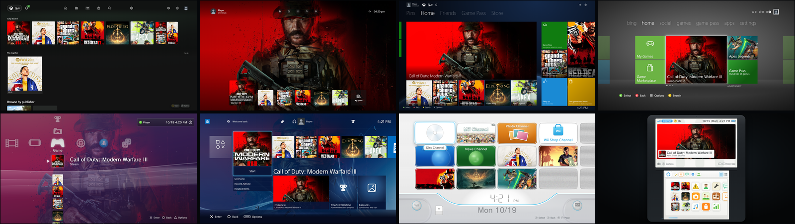
</p>

<h1 align="center">OmniDash</h1>

<p align="center"><strong>A multi-console game launcher for your TV.</strong><br>
One library from Steam, Epic, GOG, Amazon, Xbox and your own games, behind eight dashboards you can switch at any time.</p>

<p align="center">
  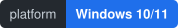
  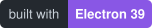
  
</p>

<p align="center">
  <a href="https://github.com/ykyritsis/OmniDash/releases/latest"><strong>Download for Windows</strong></a> &nbsp;·&nbsp;
  <a href="#themes">Themes</a> &nbsp;·&nbsp;
  <a href="#console-packs-optional">Console packs</a> &nbsp;·&nbsp;
  <a href="#settings-that-actually-work">Settings</a> &nbsp;·&nbsp;
  <a href="#controls">Controls</a> &nbsp;·&nbsp;
  <a href="#faq">FAQ</a>
</p>

> **Unofficial and fan-made.** Not affiliated with Microsoft, Sony, Nintendo or Valve. OmniDash does not bundle games, console firmware or console assets.

---

## What it does

- **One library, every launcher.** Steam, Epic, Xbox PC, GOG, Amazon, Ubisoft Connect, EA and Battle.net, plus anything you add yourself. Games are found by reading what each launcher already stores on this PC. Steam hidden games stay hidden, Steam Family libraries work, and favourites, custom collections, publisher rows and recently played are all here.
- **Launching that feels native.** Game pages with trailers, screenshots, achievements and friends who are playing. Steam launch options in a controller-friendly dialog. Pick DLC and language packs, with sizes, before an install. The launch screen follows the game's real start-up and can be cancelled.
- **Downloads.** Pause, resume, reorder and cancel Steam downloads from the Queue, and pause downloads automatically while you play.
- **Achievements.** Steam achievements, a PC Gamerscore and achievement toasts when you come back from a game.
- **Friends.** Steam friends who are online and what they are playing, with a toast when they come online.
- **Artwork that fits.** Xbox Store, Steam and SteamGridDB artwork, cached on disk. Wide art only goes in wide slots and square art in square ones.
- **Couch, handheld and quiet.** Controller, keyboard, mouse and touch everywhere, quick volume/brightness/Wi-Fi settings on handhelds, and every animation paused while a game has focus.

## Themes

A theme is a navigation model, not a recolour. Each one has its own layout, focus movement, sounds, boot animation, launch transition, notifications, on-screen keyboard and Settings screen. They all sit on the same library and the same settings registry, so switching re-renders the dashboard; it never re-scans.

<p align="center">
  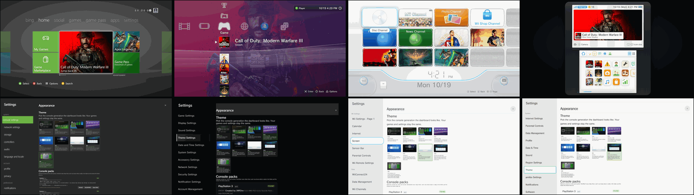
  <br><sub>The four retro consoles: Home above each console's own Settings shell.</sub>
</p>

| Theme | Dashboard | Character |
| --- | --- | --- |
| **Helix**<br><sub>PC · default</sub> | 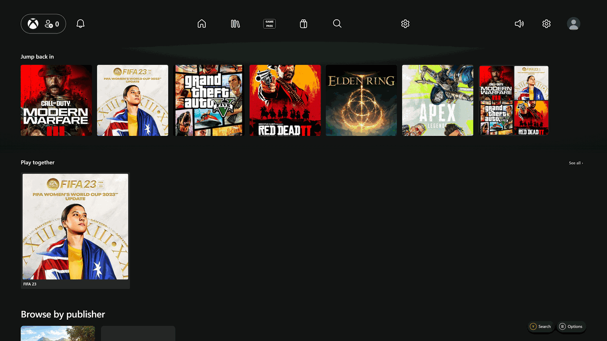 | OmniDash's own PC look: black glass, square art, quiet motion. Built for desktop and handheld PCs.<br><sub>[Settings screenshot](docs/screenshots/helix-settings.png)</sub> |
| **Xbox Series X\|S** | 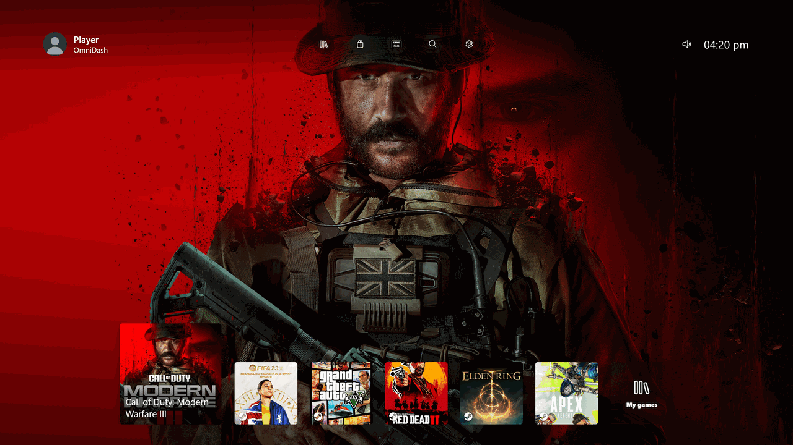 | The current Xbox dashboard: round top bar, a low row of square tiles with the focused game grown, over the game's full-screen key art.<br><sub>[Settings screenshot](docs/screenshots/series-settings.png)</sub> |
| **Xbox One (2013)** | 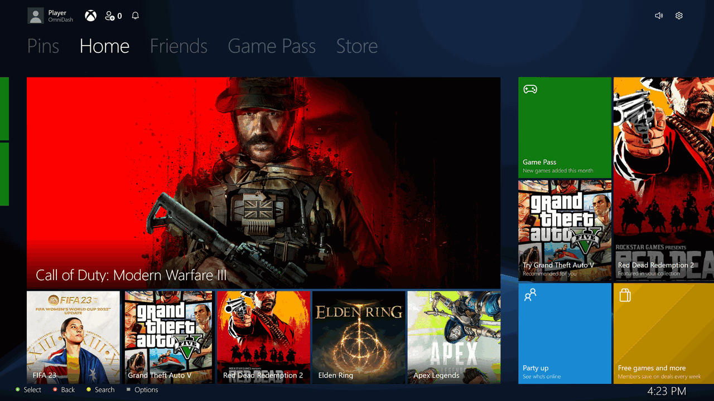 | The Metro panorama: Pins, Home, Friends, Game Pass and Store pivots, live tiles and Spotlight. LB and RB slide between hubs in place.<br><sub>[Settings screenshot](docs/screenshots/one-settings.png)</sub> |
| **Xbox 360 (Metro)** | 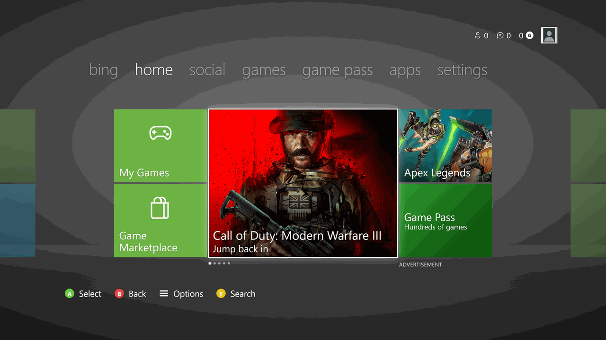 | The 2011 band: lime tiles, a rotating featured tile, the gamercard and the bing / home / social / games / apps / settings pivots.<br><sub>[Settings screenshot](docs/screenshots/x360-settings.png)</sub> |
| **PlayStation 3 (XMB)** | 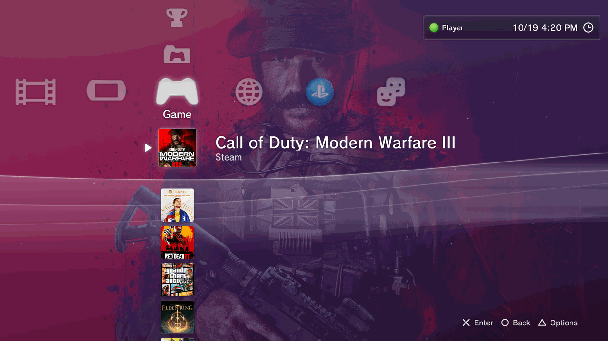 | The XrossMediaBar: categories across, items down, and a ribbon wave that follows the month's colour and the time of day. Settings live in the XMB itself.<br><sub>[Settings screenshot](docs/screenshots/ps3-settings.png)</sub> |
| **PlayStation 4** | 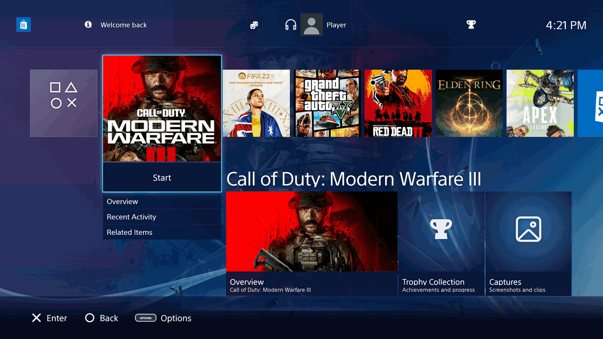 | The 2013 home row: the big Start tile, the function area, content cards and the Quick Menu.<br><sub>[Settings screenshot](docs/screenshots/ps4-settings.png)</sub> |
| **PlayStation 5**<br><sub>in progress</sub> | <sub>No polished capture yet — the theme is still being finished.</sub> | The games row over the selected game's art, activity cards and the Control Center. Implemented, but it has not had its polish pass and is not presented as finished. |
| **Wii** | 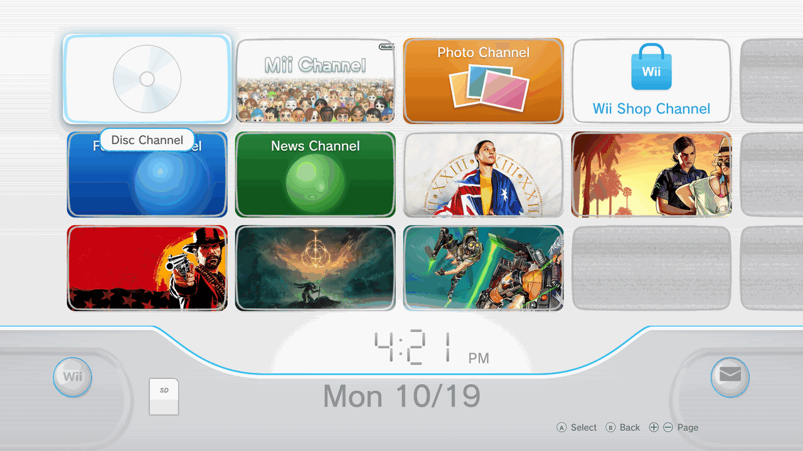 | The Wii Menu channel grid, the seven-segment clock and bottom bar, channel previews and the pointer. Wii Settings opens in the same shell.<br><sub>[Settings screenshot](docs/screenshots/wii-settings.png)</sub> |
| **Nintendo 3DS** | 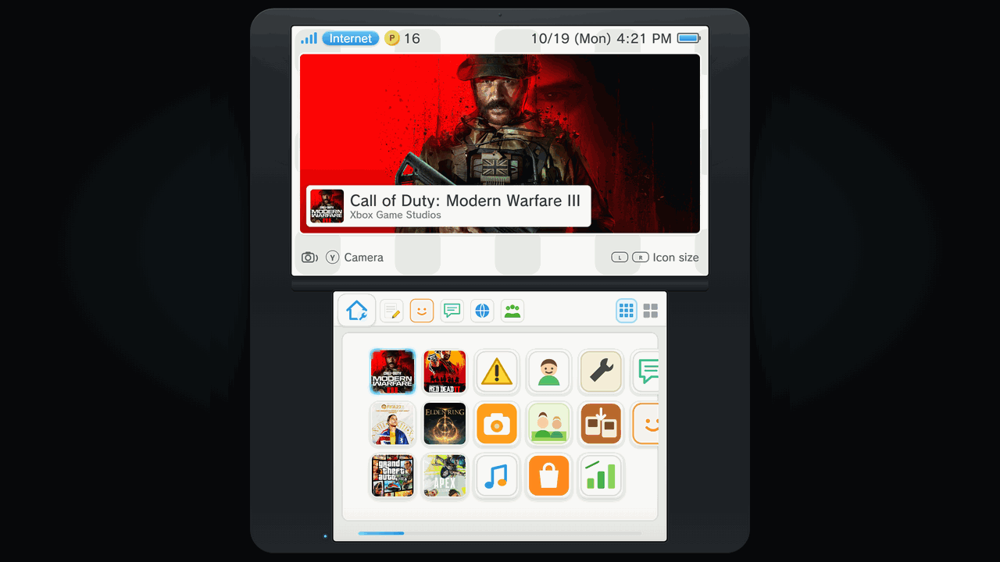 | Two screens, the icon grid, toolbar and software banner. System Settings is a 3DS settings shell, not a dialog in a costume.<br><sub>[Settings screenshot](docs/screenshots/3ds-settings.png)</sub> |

> PS5 is the one theme still in progress. The eight finished dashboards are the ones captured above. Switching between them keeps your library, focus position and settings.

## Console packs (optional)

OmniDash draws every theme itself, so each dashboard is complete straight after install. Console packs are for the original projects' icons, fonts, sounds and menu music — the details that make a recreation feel like the real thing.

| Pack | Adds | Downloaded from |
| --- | --- | --- |
| **PlayStation 3** | XMB icons, SCE PS3 font, XMB sounds and menu music | [JMRDev/XMB-PS3-Icons-Sounds-Pack-](https://github.com/JMRDev0/XMB-PS3-Icons-Sounds-Pack-) (MIT) · [CorruptionVR/PS3-Simulator](https://github.com/CorruptionVR/PS3-Simulator) (Unlicense) |
| **PlayStation 4** | Wave background, icons, SST font, sounds and menu music | [d4v1-sudo/Ps4-UI](https://github.com/d4v1-sudo/Ps4-UI) (MIT) |
| **Wii** | Channel frames, pointer and buttons, sounds, Rodin fonts and menu music | [andrewplus/Wii.JS](https://github.com/andrewplus/Wii.JS) (GPL-3) · [aica7/Liink](https://github.com/aica7/Liink) (GPL-2) |
| **Xbox 360** | Boot video, dashboard art and sounds, custom themes, optional menu music | [ZivvoZ/dashx360](https://github.com/ZivvoZ/dashx360) |
| **Series, One, 3DS, PS5** | Optional menu music only (PS5 also reads a background image); everything else is drawn by OmniDash | — |

**You supply the packs.** Open **Settings → Appearance → Console packs** and press **Install**. OmniDash downloads the files from the author's public project into your own pack folder and reloads the theme. It never hosts or redistributes them, and each folder gets an `INSTALLED-BY-OMNIDASH.txt` listing where its files came from. You can also drop your own files in: the pack manager shows the exact file names each theme reads.

Packs live in `%APPDATA%\xbox-preview-ui\theme-packs`. The full file map, licences and per-theme music order are in [docs/theme-packs.md](docs/theme-packs.md).

## Settings that actually work

Every console's Settings screen is built from one registry of real launcher options. There are no decorative rows: if OmniDash cannot change something, it does not pretend to.

- Volume, mute, screen brightness (laptops and handhelds) and the Windows power plan.
- Screen size, text size, tile corners, reduced motion and high-contrast focus.
- Interface sounds, menu music and its volume, and a 12- or 24-hour clock with your date order.
- Screen-saver delay and notification toggles for friends, downloads and achievements.
- The enter button (✕ or ○ on PlayStation), Nintendo button layout and controller vibration.
- Theme, accent colour, background and console packs.
- Accounts (Steam, Epic, SteamGridDB), updates, backup and restore.
- **Advanced (launcher)** at the bottom of every console list opens the full launcher settings.

The settings are **registry-backed**: one typed list of capabilities feeds every screen, and a test fails if any row lacks a real setting id.

**One engine, seven console-native shells.** The same settings model paints seven console-native skins — Series, One, 360, PS3, PS4, Wii and 3DS — each with the console's own chrome, fonts, glyphs and navigation. Helix uses the launcher dialog. PS5's settings shell belongs to the in-progress PS5 theme and is not counted here. Every console layout can still reach the full launcher settings through **Advanced (launcher)**.

| | |
|:---:|:---:|
| 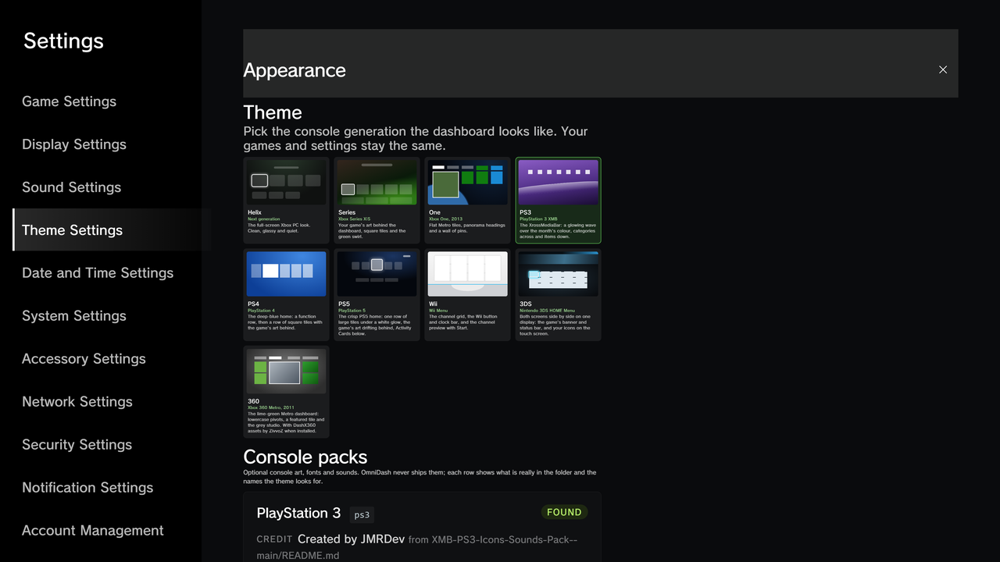 | 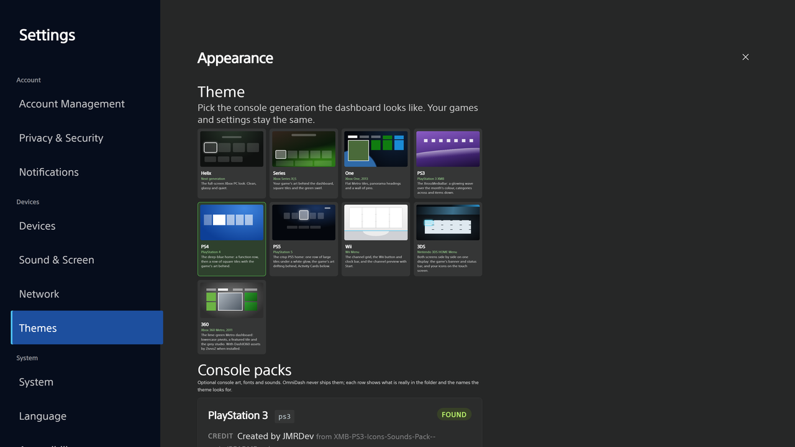 |
| <sub>PlayStation 3 · XMB Settings</sub> | <sub>PlayStation 4 · Settings</sub> |
| 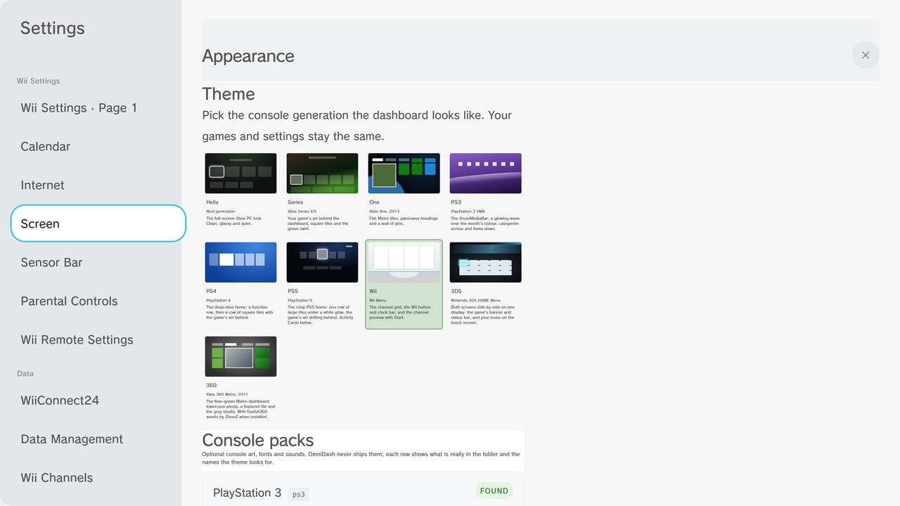 | 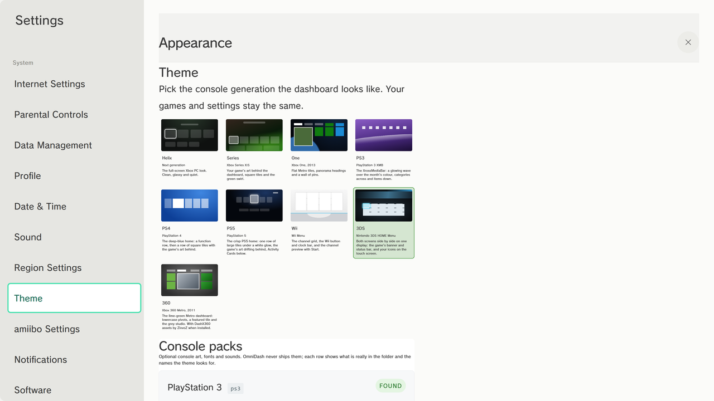 |
| <sub>Wii · Wii Settings</sub> | <sub>Nintendo 3DS · System Settings</sub> |

## Sound and motion

- **Per-console cue maps.** Move, select, back, error and boot each have their own cue per theme. Pack sounds are used when present; OmniDash's drawn fallbacks take over when they are not. The Xbox, PlayStation and Nintendo families do not share a cue map.
- **Menu music.** Each theme has an 8-second seamless drawn loop, or a real track if you drop one into its pack's `music/` folder. Menu music is separate from interface sounds, follows the master volume and mute, starts only after the first input while focused, and fades on blur and on game launch.
- **Timing tables.** Transitions use measured per-theme timings, not one global duration: PS3 180 ms, 360 160 ms, Series and One 200 ms, PS4 250 ms, Wii 300 ms, 3DS 120 ms. The tables and the reasons behind them are in [docs/HANDOVER-themes.md](docs/HANDOVER-themes.md).
- **Boot, launch and return sequences.** Every console has its own boot animation (the 360 can use DashX360's boot video), launch hands over to the game's real start-up with a cancellable overlay, and returning fades the dashboard back in rather than cutting to it.
- **Reduced motion.** The Reduced motion setting drops transitions, curtains and loops instead of merely shortening them.

## How it's built

- **Every source is read locally.** Steam library manifests, Epic install records, and the registry or manifest locations used by the other launchers. No account sync and no server, so the library works offline; anything a launcher will not report can be added by hand.
- **A theme is a navigation model.** Focus movement, confirm and back, sound cues, boot sequence, on-screen keyboard and settings screen are all part of the contract. Every theme sits on one library and one settings registry.
- **Artwork is validated, not just cached.** Wide art fills wide slots, square art fills square ones. Mismatched aspect ratios are the fastest way to make a launcher look cheap.
- **It costs nothing while you play.** When a game takes focus, every animation, video and loop pauses.
- **Updates are deliberate.** The built-in updater verifies its download and refuses to run mid-game.

## Install

1. Download **OmniDash-Setup** (installer) or **OmniDash-Portable** (no install) from [Releases](https://github.com/ykyritsis/OmniDash/releases/latest). Windows 10 or 11, 64-bit.
2. On the first screen, pick a dashboard and your profile. Installed games are found automatically.
3. Optional: add a **SteamGridDB key** (Settings → Manage games & add-ons → Artwork services) for artwork gaps, or a **Steam Web API key** for uninstalled games, achievement progress and friends.
4. Optional: install **console packs** in Settings → Appearance.

Builds are not code-signed yet, so Windows SmartScreen may warn on first run. Choose **More info → Run anyway** if you trust the build. Your settings, caches and packs live in `%APPDATA%\xbox-preview-ui` and survive updates; uninstalling leaves that folder alone unless you delete it.

**From source** — Node.js 22.5 or newer:

```powershell
npm install
npm run prepare:streaming
npm start
```

Run `npm test` for the full suites and `npm run test:unit` for the ones that need no Electron runtime. Build with `npm run dist` (installer) or `npm run dist:portable`. Developer notes are in [docs/HANDOVER-themes.md](docs/HANDOVER-themes.md).

## Controls

| Input | Action |
| --- | --- |
| D-pad / left stick | Move |
| A / ✕ | Select, open, or play |
| B / ○ | Back |
| Y / △ | Search (PS3: Options) |
| Menu / OPTIONS | Options for the focused game |
| View | My games & apps |
| LB / RB | Switch hubs (Xbox One, 360) or pages (Wii) |
| Xbox / PS / HOME button | Windows Game Bar, or the theme's own menu |

- **Every theme draws its own glyphs.** A PlayStation theme never shows an A button; a Nintendo theme shows its own faces. Pack fonts do not change the glyph vocabulary.
- **Enter button.** The PlayStation themes can use ✕ or ○ as Enter. The other face button becomes Back and the on-screen hints flip with it.
- **Nintendo layout.** The Nintendo setting swaps the confirm and back faces to match the pad in your hand, for Wii and 3DS.
- **Keyboard.** Arrow keys move, Enter selects, Esc goes back, `O` opens options for the focused game, Home jumps to the top, and Tab cycles the controls in a dialog.
- **Mouse and touch** work everywhere; controller vibration can be turned off in Settings.

## Privacy

OmniDash has no account, no server and no telemetry. It does not send usage data, crash reports or a device identifier anywhere.

Everything it knows lives under `%APPDATA%\xbox-preview-ui`: settings, library snapshots, cached artwork, pack files and any optional API keys. Network access is limited to the job at hand:

- Artwork and metadata from the Xbox Store, Steam, SteamGridDB and the store pages you open.
- Update checks against GitHub Releases.
- A console pack, only when you press **Install**, downloaded from that project's public repository.
- Remote play, on your own network.
- Steam sign-in and store pages, in their own sandboxed web sessions.

Optional Steam and SteamGridDB keys are stored locally and sent only to the service they belong to. Nothing is sent to OmniDash itself, because there is nowhere to send it.

## FAQ

<details>
<summary><strong>Is OmniDash an emulator?</strong></summary>

No. It launches PC games you already own from the launchers on your PC. The console themes are dashboards, not emulators, and OmniDash does not supply console games or firmware.
</details>

<details>
<summary><strong>Do I need a console pack?</strong></summary>

No. Every theme is complete without one. Packs add the original projects' icons, fonts, sounds and menu music if you want them.
</details>

<details>
<summary><strong>Are console assets bundled?</strong></summary>

No. The repository contains OmniDash's own drawn assets only. Optional packs are fetched from their authors' public projects at your request, and their rights stay with those authors and the console makers. See [docs/theme-packs.md](docs/theme-packs.md).
</details>

<details>
<summary><strong>Why does Windows warn about the installer?</strong></summary>

Builds are not code-signed yet. SmartScreen warns about any unsigned installer with a low download count. Choose **More info → Run anyway** if you trust the release.
</details>

<details>
<summary><strong>Is the PS5 theme finished?</strong></summary>

Not yet. It is in progress and is not part of the polished screenshot set. The other eight dashboards are finished.
</details>

<details>
<summary><strong>Does it work offline?</strong></summary>

Your library and launching work offline. Artwork, store pages, friends and update checks need a connection.
</details>

<details>
<summary><strong>Which controllers are supported?</strong></summary>

Anything Windows exposes through the Gamepad API, including Xbox, PlayStation and Nintendo-style pads. Each theme prints its own button glyphs, so the hints match the console you are pretending to use.
</details>

<details>
<summary><strong>Does OmniDash replace Windows Explorer or Xbox mode?</strong></summary>

No. It is a normal desktop app that can run full-screen. Xbox Mode Home integration is optional and off by default.
</details>

<details>
<summary><strong>Where is my data, and how do I remove it?</strong></summary>

Everything is in `%APPDATA%\xbox-preview-ui`. Uninstalling the app leaves it in place; delete that folder to remove settings, caches and packs.
</details>

## How it's built

The theming is the visible part. The launcher layer underneath is the hard part.

**One library, many sources.** Games are discovered by reading what each launcher already stores locally — Steam's library manifests, Epic's install records, and the registry or manifest locations used by Ubisoft Connect, EA, Battle.net, GOG, Xbox PC and Amazon — rather than by scraping their interfaces. No account sync, no server, and it works offline. Anything a launcher won't report can be added by hand.

**Every theme is a navigation model, not a recolour.** A full-screen console dashboard has to specify how focus moves, what confirm and back do, which sounds fire on move / select / back, what the boot sequence looks like, how the on-screen keyboard is laid out and what its settings screen contains. Nine of those sit on one library and one settings registry: switching themes re-renders, it never re-scans. Each theme implements the same contract, documented in [`docs/HANDOVER-themes.md`](docs/HANDOVER-themes.md), with the file map in [`docs/theme-packs.md`](docs/theme-packs.md).

**Artwork is validated, not just cached.** Xbox Store, Steam and SteamGridDB are queried in that order and cached on disk. Wide art only fills wide slots and square art only fills square ones — a mismatched aspect ratio is the fastest way to make a launcher look cheap. Sources rate-limit; misses fall back to user-supplied art.

**Costs nothing while you play.** When a game takes focus, every animation, video and loop pauses. A launcher that eats GPU time in the background is worse than no launcher.

**Updates are deliberate.** The built-in updater verifies its download and refuses to run mid-game.

Tests: `npm test` runs the full suites; `npm run test:unit` covers what needs no Electron runtime.

## Limits

- Discovery reads local launchers and manifests. It is not a full account sync with every store.
- Steam account data depends on your API key and profile visibility. Artwork sources can rate-limit or miss a match; you can always set your own.
- Some third-party launcher windows, sign-ins and Windows prompts still appear outside OmniDash.
- PS5 is in progress. Console themes are recreations made from public reference material.
- Packs are optional, come from third-party projects, and are supplied by you. OmniDash does not bundle or redistribute them.
- Builds are unsigned, so SmartScreen may warn on first run.

## Credits

OmniDash's themes are original recreations; the optional packs come from these projects, and their assets remain theirs:

- **DashX360** by [ZivvoZ](https://github.com/ZivvoZ/dashx360) — Xbox 360 boot video, dashboard art and sounds.
- **PS4 UI** by [d4v1-sudo](https://github.com/d4v1-sudo/Ps4-UI) — PS4 wave background, icons, SST font and sounds (MIT).
- **PS3 icons and sounds** by [JMRDev](https://github.com/JMRDev0/XMB-PS3-Icons-Sounds-Pack-) — XMB icons, sounds and menu music (MIT).
- **PS3 Simulator** by [CorruptionVR](https://github.com/CorruptionVR/PS3-Simulator) — PS3 icons and SCE font (Unlicense).
- **Wii.JS** by [andrewplus](https://github.com/andrewplus/Wii.JS) — channel frames, pointer and sounds (GPL-3).
- **Liink** by [aica7](https://github.com/aica7/Liink) — Rodin fonts (GPL-2).

Remote play bundles the unmodified [StreamLight 7.0.0 runtime](https://github.com/FoggyBytes/StreamLight/tree/v7.0.0), based on Moonlight, under [GPL v3](src/remote-play/LICENSE.StreamLight). Launcher brand symbols are from [Simple Icons](https://github.com/simple-icons/simple-icons) (CC0). System icons use Windows' Segoe MDL2 Assets.

Xbox, Xbox Game Pass and Microsoft; PlayStation, PS3, PS4, PS5 and XMB; Wii, Nintendo 3DS and Nintendo; Steam; and all game names, logos and artwork belong to their respective owners. Nothing here implies sponsorship, approval or affiliation.

## License

OmniDash's own code is **MIT** — see [LICENSE](LICENSE). The bundled StreamLight runtime in `src/remote-play/` remains under **GPL v3** and keeps its own licence file. Console and game assets are not covered by either: they belong to their owners, and the optional packs keep their own licences.
