# OmniDash

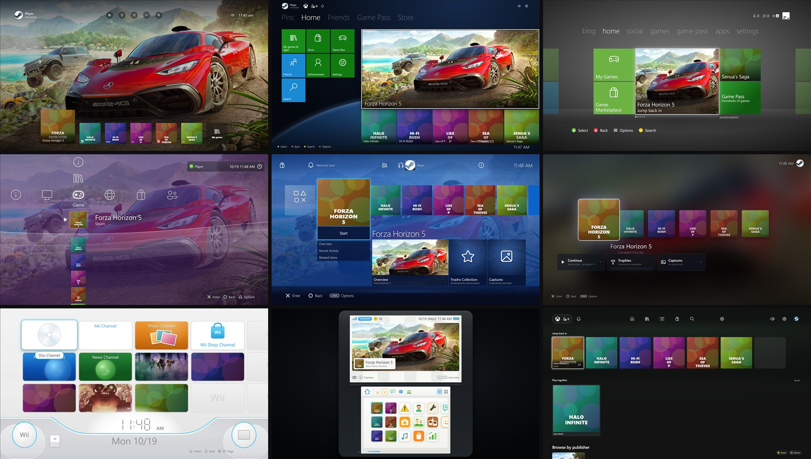

**One game launcher, nine console dashboards.** OmniDash is a full-screen, controller-first launcher for Windows. It gathers every game you have installed from Steam, Epic, GOG, Amazon, Xbox PC and other launchers into one library. Then it lets you browse that library the way you remember, as an Xbox Series X|S, Xbox One, Xbox 360, PlayStation 3, PlayStation 4, PlayStation 5, Wii or Nintendo 3DS dashboard, or as a clean modern PC launcher.

**[Download OmniDash 0.6.1](https://github.com/ykyritsis/OmniDash/releases/latest)** ([notes](docs/release-0.6.1.md)) · [Themes](#nine-dashboards) · [Console packs](#console-packs-one-click) · [Getting started](#getting-started) · [Controls](#controls)

> Unofficial, fan-made project. Not affiliated with Microsoft, Sony, Nintendo or Valve. See [Legal](#legal-and-attribution).

---

## Nine dashboards

Pick a dashboard during setup or any time in **Settings → Appearance**. Every theme sits on the same library, so switching never re-scans anything. Each one has its own layout, navigation, focus style, sounds, boot screen, launch sequence, notifications, on-screen keyboard and Settings screen.

| | |
| --- | --- |
| 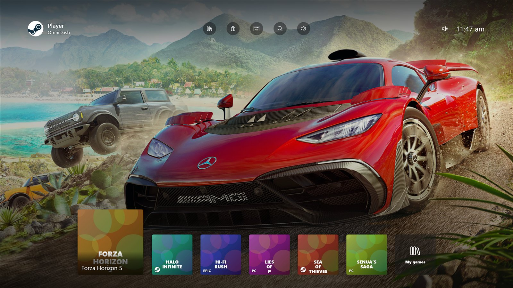 **Xbox Series X\|S.** The current dashboard: profile corner, round top bar, a low row of square tiles with the selected game grown, on the game's full-screen key art. | 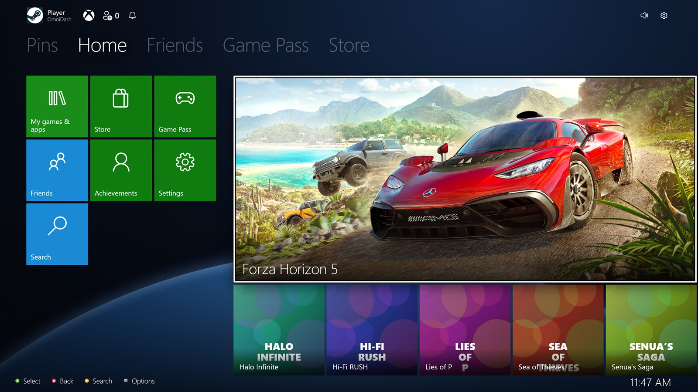 **Xbox One (2013).** The Metro Home with Pins, Friends, Game Pass and Store pivots, live tiles and Spotlight. LB and RB switch hubs in place. |
| 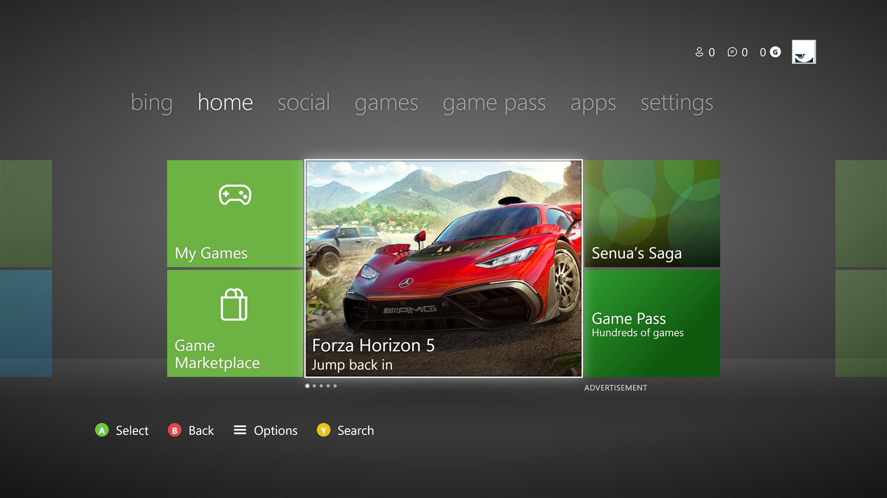 **Xbox 360 (Metro).** The 2011 dashboard band with its lime tiles, the rotating featured tile, gamercard and hub pivots (bing, home, social, games, apps, settings). | 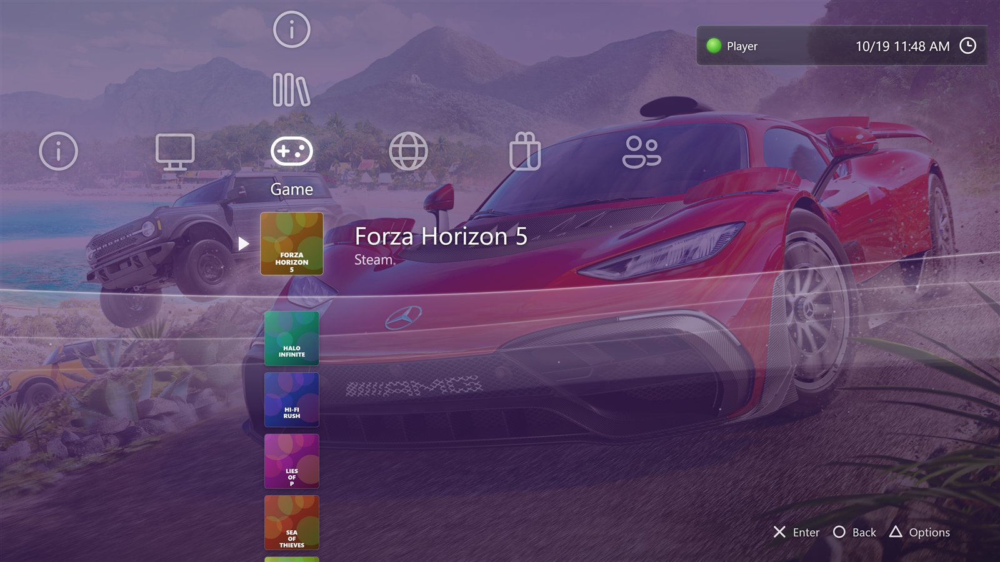 **PlayStation 3.** The XrossMediaBar, with categories across and items down. The ribbon wave follows the month's colour and the time of day. Settings live in the XMB itself. |
| 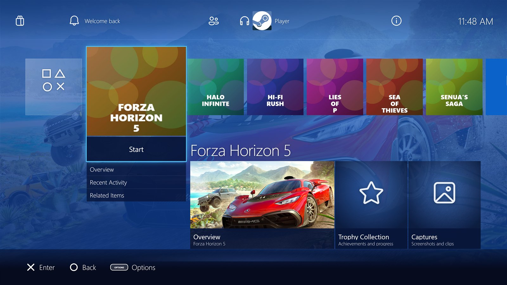 **PlayStation 4.** The 2013 home row with the big Start tile, the function area, content cards with your achievements, and the Quick Menu. | 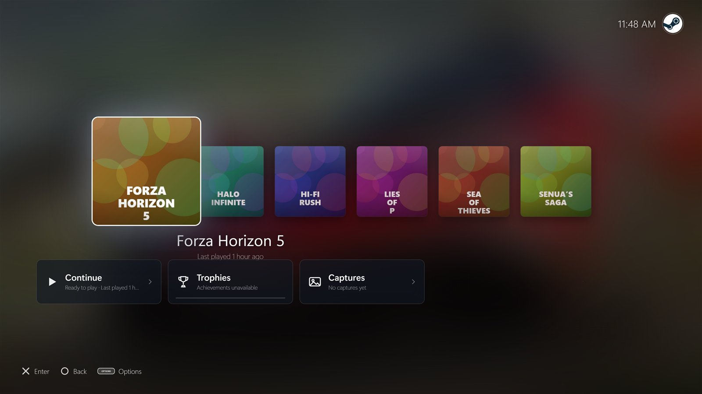 **PlayStation 5.** The games row over the selected game's art, activity cards and the Control Center. |
| 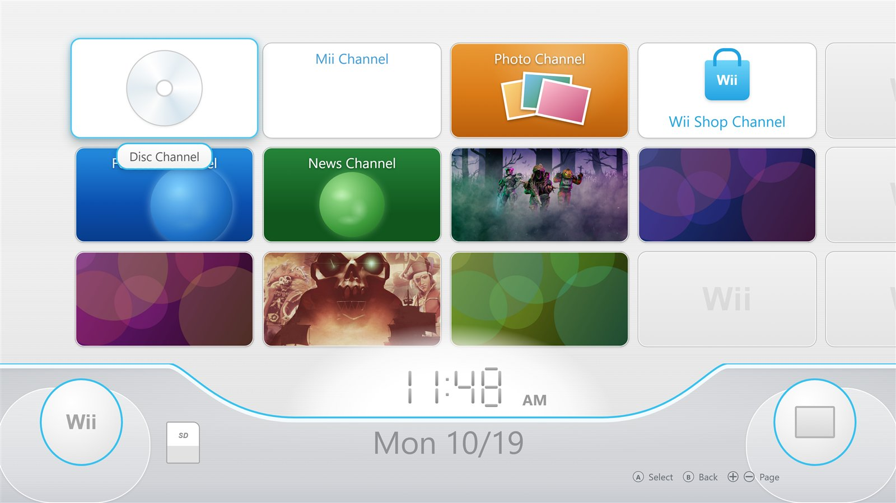 **Wii.** The Wii Menu's channel grid, the seven-segment clock and bottom bar, channel previews with Wii Menu / Start, the HOME Menu and Wii Settings pages. | 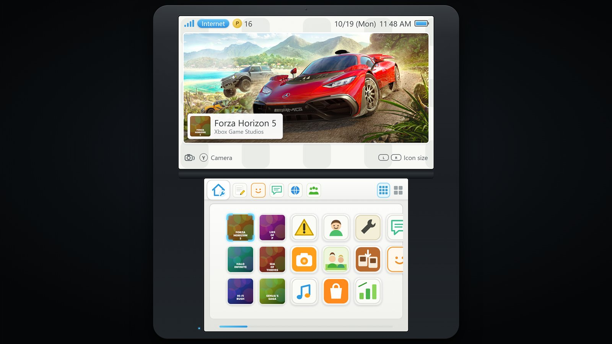 **Nintendo 3DS.** The HOME Menu's two screens (stacked, side by side or large top screen), the toolbar, the icon grid and the software banner. |
| 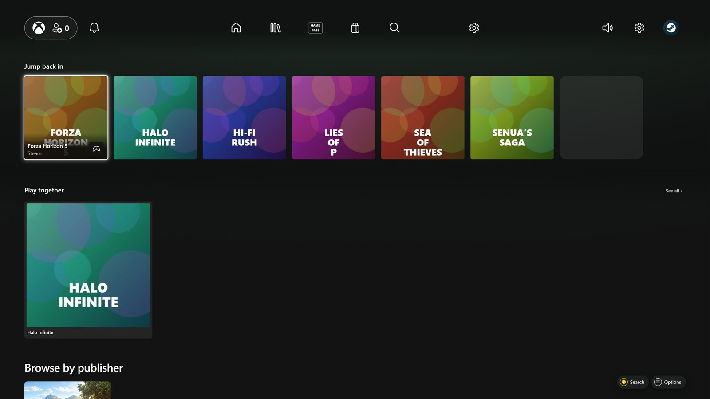 **Helix (PC).** OmniDash's own modern look, for desktop and handheld PCs. | 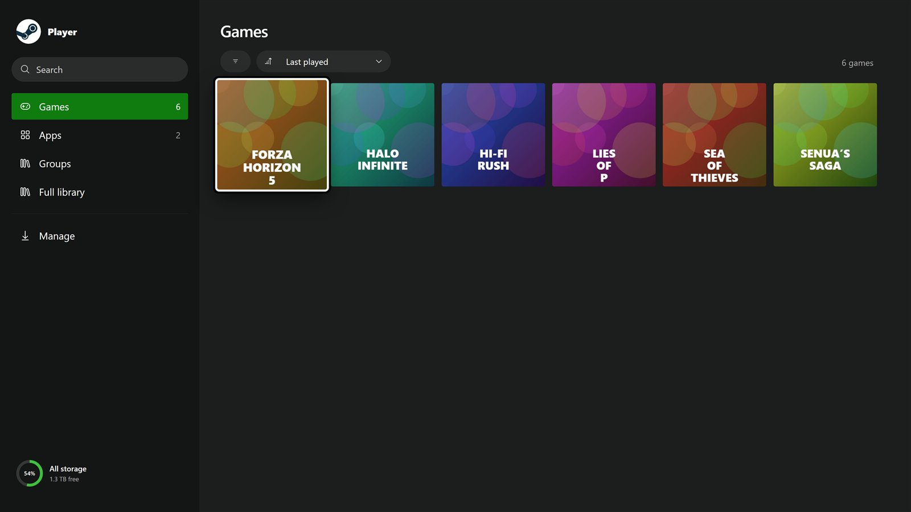 **My games & apps.** A full-screen console library in every theme, with sections, counts, sorting and storage. |

### Settings that really change things

Every console's Settings screen is built from one registry of real launcher options. There are no decorative rows: if OmniDash can't change something, it doesn't pretend to.

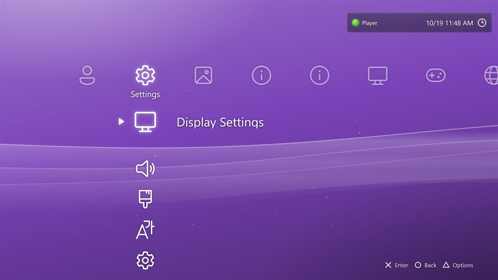 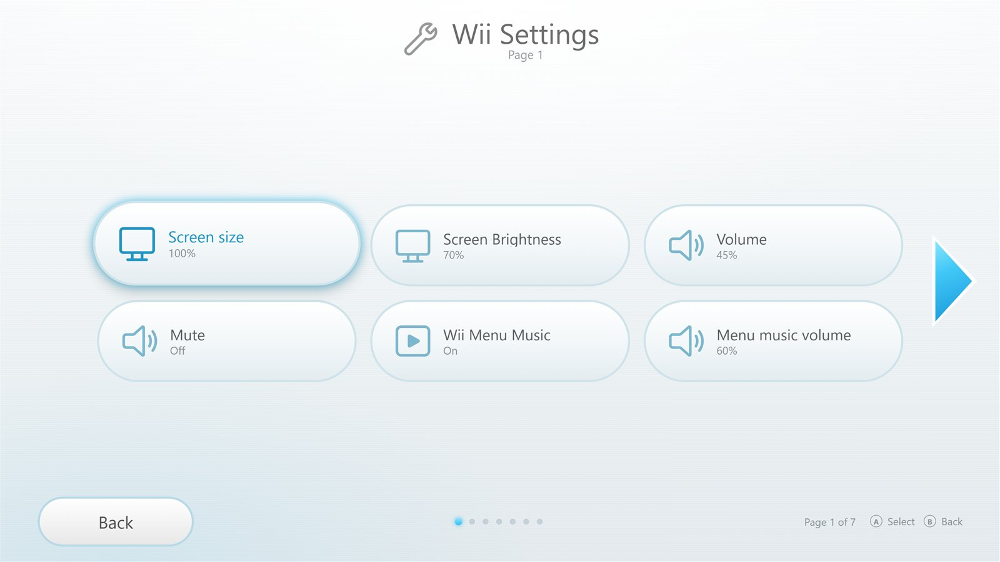 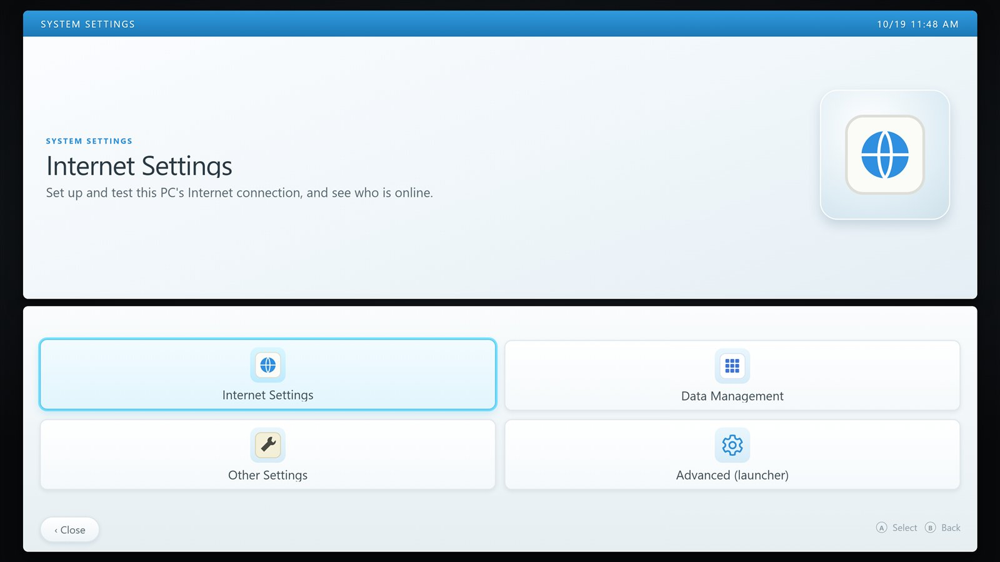

- Volume, mute, screen brightness (laptops and handhelds) and the Windows power plan.
- Screen size, text size, tile corners, reduced motion and high-contrast focus.
- Interface sounds, menu music and its volume, and a 12- or 24-hour clock with your date order.
- Screen-saver delay and notification toggles (friends, downloads, achievements).
- The enter button (✕ or ○ on PlayStation), Nintendo button layout and controller vibration.
- Theme, accent colour, background and console packs.
- Accounts (Steam, Epic, SteamGridDB), updates, backup and restore.
- **Advanced (launcher)** at the bottom of every console list opens the full launcher settings.

---

## Console packs (one click)

OmniDash draws every theme itself, so each one is complete straight after install. For the consoles' real icons, fonts, sounds and menu music, open **Settings → Appearance → Console packs** and press **Install**. OmniDash downloads the pack from the original public project that publishes it, straight into your own pack folder, and reloads the theme.

| Pack | Downloaded from | Adds |
| --- | --- | --- |
| PlayStation 3 | [CorruptionVR/PS3-Simulator](https://github.com/CorruptionVR/PS3-Simulator), [JMRDev0/XMB-PS3-Icons-Sounds-Pack-](https://github.com/JMRDev0/XMB-PS3-Icons-Sounds-Pack-) | XMB icons, PS3 system font, XMB sounds and music |
| PlayStation 4 | [d4v1-sudo/Ps4-UI](https://github.com/d4v1-sudo/Ps4-UI) | Wave background, icons, SST font, sounds |
| Wii | [andrewplus/Wii.JS](https://github.com/andrewplus/Wii.JS), [aica7/Liink](https://github.com/aica7/Liink) | Channel frames, buttons, Wii pointer, sounds, Rodin fonts |
| Xbox 360 | [ZivvoZ/dashx360](https://github.com/ZivvoZ/dashx360) | Boot video, dashboard sounds, tiles and themes |

OmniDash never hosts or redistributes these files. They're downloaded on your request, for your own use, from their authors' projects, and their rights stay with those authors and the console makers. Each pack folder gets an `INSTALLED-BY-OMNIDASH.txt` listing where its files came from. You can also drop your own files into a pack folder; the pack manager shows exactly which file names each theme reads.


---

## Everything else it does

<details open>
<summary><strong>One library from every launcher</strong></summary>

- Discovers installed games from Steam, Epic, Xbox PC, Ubisoft Connect, EA, Battle.net, GOG and Amazon, plus anything you add yourself.
- Steam hidden games stay hidden, and hiding a game in OmniDash syncs to Steam. Steam Family libraries are supported.
- Favourites, custom and smart collections, publisher and series rows, and recently added and recently played.
- Artwork from the Xbox Store, Steam and (with your key) SteamGridDB, cached on disk. Wide art only goes in wide slots and square art in square ones.

</details>

<details>
<summary><strong>Game pages, launching and downloads</strong></summary>

- Game pages with descriptions, screenshots, trailers, input support, achievements, your captures and friends who are playing.
- Steam launch options in a controller-friendly dialog. The launch screen follows the game's start-up and lets you cancel for real.
- Choose DLC and language packs, with sizes, before a Steam install. Pause, resume, reorder and cancel Steam downloads from the Queue.
- Pause downloads while you play, and return to a running game.

</details>

<details>
<summary><strong>Store, Game Pass, friends and achievements</strong></summary>

- Xbox Store browsing, the PC Game Pass catalogue and Steam search for games you don't own yet.
- Steam friends who are online and what they're playing, with toasts when friends come online.
- Steam achievements, a PC Gamerscore and achievement toasts when you come back from a game.

</details>

<details>
<summary><strong>Built for the couch, handhelds and quiet background running</strong></summary>

- Controller, keyboard, mouse and touch everywhere, with each console's own on-screen keyboard and button glyphs.
- Quick settings for handhelds: volume, brightness, Wi-Fi, battery and power plan.
- While a game is in front, every animation, video and loop pauses, so OmniDash costs next to nothing.
- A built-in updater with verified downloads; it never updates mid-game.
- Remote play preview (StreamLight / Moonlight), optional Xbox Mode Home integration, and a power menu with sleep, restart and shut down.

</details>

---

## Getting started

1. Download **OmniDash-Setup** (installed) or **OmniDash-Portable** (no install) from [Releases](https://github.com/ykyritsis/OmniDash/releases/latest).
2. Pick a dashboard and your profile on the first screen. Installed games are found automatically.
3. Optional:
   - Add a **SteamGridDB key** (Settings → Library → Artwork services) to fill artwork gaps.
   - Add a **Steam Web API key** for uninstalled games, achievement progress and friends.
4. Optional: install **console packs** in Settings → Appearance.

Builds aren't code-signed yet, so Windows SmartScreen may warn on first run: choose **More info → Run anyway** if you trust the source. Your settings, caches and packs live in `%APPDATA%\xbox-preview-ui` and survive updates.

## Controls

The confirm button is A on Xbox-style pads. It follows each theme's layout, and the PlayStation themes can use ✕ or ○ as Enter.

| Input | Action |
| --- | --- |
| D-pad / left stick | Move |
| A / ✕ | Select, open, or play |
| B / ○ | Back |
| Y / △ | Search (PS3: Options) |
| Menu / OPTIONS | Options for the focused game |
| View | My games & apps |
| LB / RB | Switch hubs (Xbox One, 360) or pages (Wii) |
| Xbox / PS / HOME button | Windows Game Bar, or the theme's own menu |

## Build from source

You need Node.js 22.5 or newer.

```powershell
npm install
npm run prepare:streaming
npm start
```

Run `npm test` for the full suites and `npm run test:unit` for the ones that need no Electron runtime. Build with `npm run dist` (installer) or `npm run dist:portable`. Developer notes for the themes are in [docs/HANDOVER-themes.md](docs/HANDOVER-themes.md), with the pack map in [docs/theme-packs.md](docs/theme-packs.md).

## How it's built

The theming is the visible part. The launcher layer underneath is the hard part.

**One library, many sources.** Games are discovered by reading what each launcher already stores locally — Steam's library manifests, Epic's install records, and the registry or manifest locations used by Ubisoft Connect, EA, Battle.net, GOG, Xbox PC and Amazon — rather than by scraping their interfaces. No account sync, no server, and it works offline. Anything a launcher won't report can be added by hand.

**Every theme is a navigation model, not a recolour.** A full-screen console dashboard has to specify how focus moves, what confirm and back do, which sounds fire on move / select / back, what the boot sequence looks like, how the on-screen keyboard is laid out and what its settings screen contains. Nine of those sit on one library and one settings registry: switching themes re-renders, it never re-scans. Each theme implements the same contract, documented in [`docs/HANDOVER-themes.md`](docs/HANDOVER-themes.md), with the file map in [`docs/theme-packs.md`](docs/theme-packs.md).

**Artwork is validated, not just cached.** Xbox Store, Steam and SteamGridDB are queried in that order and cached on disk. Wide art only fills wide slots and square art only fills square ones — a mismatched aspect ratio is the fastest way to make a launcher look cheap. Sources rate-limit; misses fall back to user-supplied art.

**Costs nothing while you play.** When a game takes focus, every animation, video and loop pauses. A launcher that eats GPU time in the background is worse than no launcher.

**Updates are deliberate.** The built-in updater verifies its download and refuses to run mid-game.

Tests: `npm test` runs the full suites; `npm run test:unit` covers what needs no Electron runtime.

## Limits

- Discovery reads local launchers and manifests. It isn't a full account sync with every store.
- Steam account data depends on your API key and profile visibility. Artwork sources can rate-limit or miss a match; you can always set your own.
- Some third-party launcher windows, sign-ins and Windows prompts still appear outside OmniDash.
- Console themes are recreations made from public reference material. Packs are optional and come from third-party projects.

## Legal and attribution

OmniDash is a fan-made, unofficial launcher. Xbox, Xbox Game Pass and Microsoft; PlayStation, PS3, PS4, PS5 and XMB; Wii, Nintendo 3DS and Nintendo; Steam; and all game names, logos and artwork belong to their respective owners. Nothing here implies sponsorship, approval or affiliation. OmniDash doesn't bundle games, grant licences, bypass DRM or ship console assets. Optional packs are fetched only on the user's request from their authors' public projects.

Remote play bundles the unmodified [StreamLight 7.0.0 runtime](https://github.com/FoggyBytes/StreamLight/tree/v7.0.0), based on Moonlight, under [GPL v3](src/remote-play/LICENSE.StreamLight). Launcher brand symbols are from [Simple Icons](https://github.com/simple-icons/simple-icons) (CC0). System icons use Windows' Segoe MDL2 Assets.

## Licence

OmniDash's own code is MIT — see [LICENSE](LICENSE). `src/remote-play/` bundles the unmodified StreamLight runtime, which remains under GPL v3 and keeps its own licence file.
