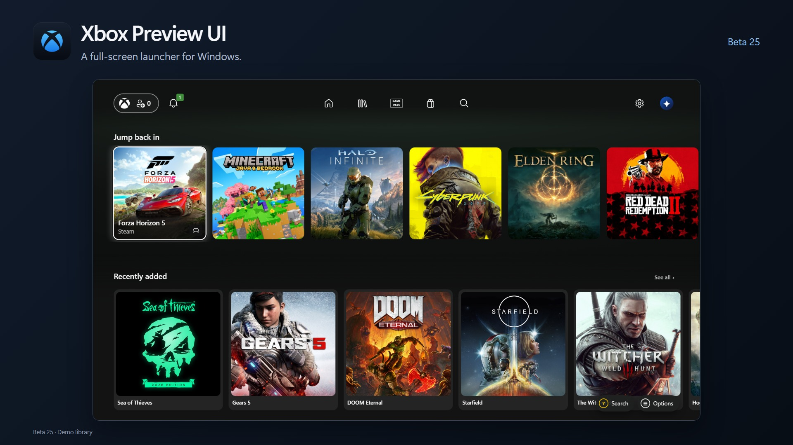
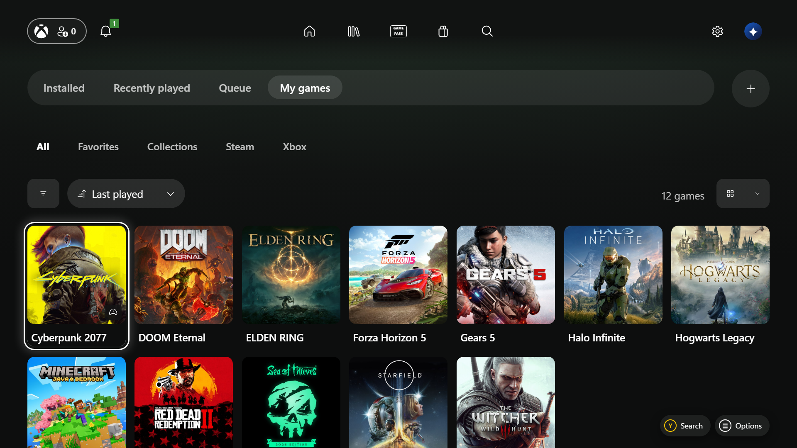
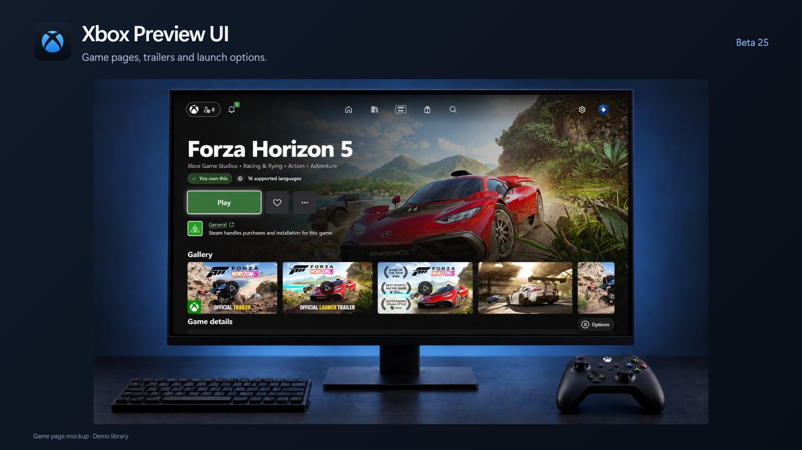
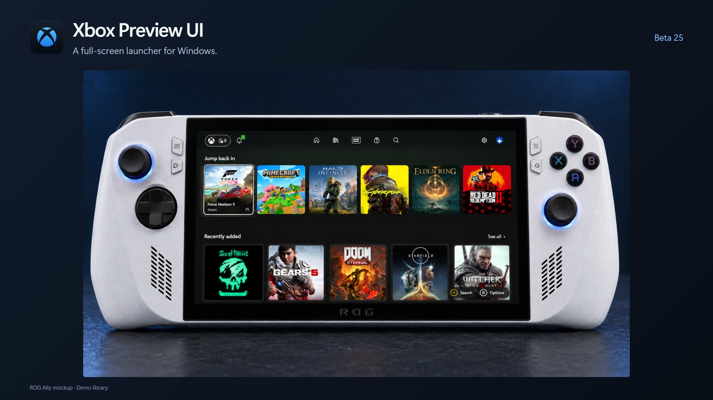
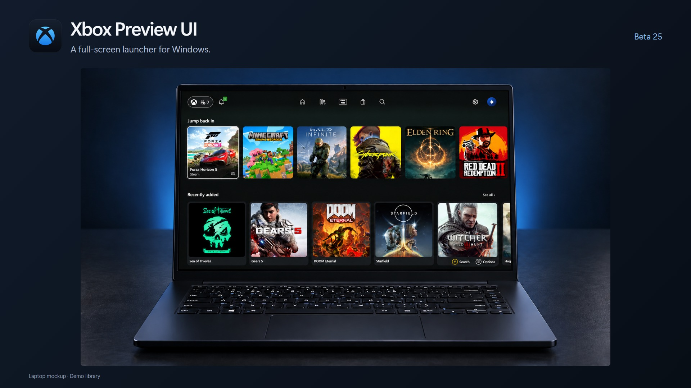

# Xbox Preview UI



A full-screen Windows launcher with controller navigation, a shared game library and Steam launch options.

**[Download beta 26](https://github.com/ykyritsis/xbox-cloud-preview-on-pc/releases/download/v0.27.0-beta.26/Xbox-Preview-UI-Setup-0.27.0-beta.26.exe)** · [Setup](#getting-started) · [Beta 26 notes](docs/release-0.27.0-beta.26.md)

- Browse installed games from Steam, Epic, Xbox PC and other launchers.
- Use a controller, mouse or keyboard.
- Select supported Steam launch modes and follow first-run setup.
- Manage downloads, favourites, collections and artwork.

Unofficial community project. Images show beta 25 with a sample library; available builds are listed on the Releases page.

## Screenshots





[Onboarding](docs/promo/beta25-v2/promo-onboarding.jpg) · [Library connections](docs/promo/beta25-v2/promo-libraries.jpg) · [Library on ROG Ally](docs/promo/beta25-v2/promo-library.jpg)

## Device mockups

| ROG Ally | Laptop |
| --- | --- |
|  |  |

[Desktop mockup](docs/promo/beta25-v2/promo-desktop.jpg) · [Full screenshot](docs/promo/beta25-v2/screenshot-home.png)

Device images are illustrative mockups based on app captures, not photographs of a hardware test.

## Beta 26

- Current dashboard styling for library management, duplicate selection and launch options.
- Galleries remove repeated media; Steam lookup shares requests and reuses regional caches.
- Regional age ratings, including Australian classifications, with a manual region override.
- [Fourteen publisher cards and twelve series banners](docs/collection-artwork/README.md) use finished local promotional designs with clean logos.

[Full release notes](docs/release-0.27.0-beta.26.md)

## Download

Get **[beta 26 from GitHub Releases](https://github.com/ykyritsis/xbox-cloud-preview-on-pc/releases/tag/v0.27.0-beta.26)**. Download the Setup executable for your handheld or desktop.

| File | Choose this for |
| --- | --- |
| `Xbox-Preview-UI-Setup-x.y.z.exe` | An installed copy with a Start menu entry and uninstaller. |
| `Xbox-Preview-UI-Portable-x.y.z.exe` | Running without installation. Replace the executable to update; settings remain in Windows app data. |
| `SHA256SUMS.txt` | Verifying the downloaded files. |

Builds are not code-signed yet, so Windows SmartScreen may warn on first run. Choose **More info → Run anyway** if you trust the source.

## Getting started

1. Install or unpack your downloaded build, then choose a profile.
2. Connect your libraries. Installed games are discovered from local launchers and manifests.
3. Optionally add a **SteamGridDB key** in **Settings → Manage games → Artwork** to fill artwork gaps. Get a key from your SteamGridDB account's Preferences → API.
4. Enable **Steam download controls** from the Queue to pause and resume Steam downloads. The connection stays on this PC (`127.0.0.1`).

Installed Steam games, recorded local playtime and Steam's hidden-game list need no API key. A Steam Web API key enables additional account data, including uninstalled games, personal achievement progress and verified friend presence, subject to your Steam privacy settings.

## More under the hood

<details>
<summary><strong>Home, library and game pages</strong></summary>

- Jump back in, Recently added, favourites, custom collections, controller-friendly games and multiplayer shelves.
- Steam friend activity shows verified friends who are currently in a game.
- Library tabs for Installed, Recently played, Queue and My games, with filters, sorting and grid/list layouts.
- Launcher discovery for Steam, Epic, Xbox PC, Ubisoft Connect, EA, Battle.net, GOG and Amazon where installed locally.
- Artwork-led game pages with descriptions, screenshots, trailers where available, input support and achievements.
- Manage artwork, files, shortcuts, collections, favourites, hiding and uninstalling from game options.
- Steam hidden games stay hidden until you choose to show them; hiding a Steam game syncs with Steam.
- Return to game is available while a tracked game is running.

</details>

<details>
<summary><strong>Steam, downloads and account connections</strong></summary>

- Supported Steam launch choices appear in a controller-friendly dialog before launch.
- Launch progress follows game startup and first-run setup; supported Steam requests appear in the app.
- Steam Queue controls include pause, resume, move to top, pause/resume all and cancellation through Steam.
- Steam Family libraries, Steam achievements and PC Gamerscore from verified achievements.
- Steam sign-in and cart pages use a separate sandboxed in-app browser session.
- Xbox Store browsing, PC Game Pass catalog and Steam search results for additional games.
- Account integrations have different setup requirements. See [library connections](docs/library-connections.md).

</details>

<details>
<summary><strong>Personalisation, performance and updates</strong></summary>

- Interface scaling, reduced motion and high-contrast focus.
- Optional interface sounds and local sound packs.
- Artwork and metadata caches for quicker return visits; manual artwork replacement.
- Background work and animations pause while a game is in front.
- Built-in update checks, verified downloads and installation on restart or app exit.
- Power menu with confirmed sleep, restart and shutdown.
- Optional Xbox Mode Home app integration: [setup guide](docs/xbox-mode.md).

</details>

## Controller controls

| Input | Action |
| --- | --- |
| D-pad / left stick | Move focus |
| A | Select, open a game, or activate the focused action |
| B | Back; return Home from the Library |
| Y | Search |
| Menu | Options for the focused game |
| View | My games & apps, or Home |
| Xbox button | Windows Game Bar |

## Run or build from source

Install Node.js 20 or newer, then:

```powershell
npm install
npm start
```

Create Windows builds:

```powershell
npm run dist
npm run dist:portable
```

Builds are written to `dist/`. The installer does not change Windows' Full Screen Experience Home app or install a certificate. See [Xbox Mode setup](docs/xbox-mode.md) for the optional integration.

## Preview limits

- Discovery reads local manifests and installed-game folders; it is not a complete account sync with every store.
- Steam account data depends on API access and profile visibility. Achievement catalogs for matching non-Steam editions are reference-only unless linked progress is available.
- Artwork and metadata sources can rate-limit, change or have no match. You can supply your own artwork.
- Some Steam dialogs, third-party launchers, sign-in windows and Windows prompts can still appear externally.
- Native keyboard placement is managed by Windows. Beta 25 was checked at handheld resolution and against Windows InputPane, but not on the physical handheld.
- Epic uninstalled-game support needs a signed-in Legendary helper. See [library connections](docs/library-connections.md).
- SteamDB is not scraped; Game Options lets you enter a Steam App ID manually.

## Recent changes

| Preview | Highlights |
| --- | --- |
| [Beta 26](docs/release-0.27.0-beta.26.md) | Updated management dialogs, unique gallery media, quicker Steam lookup, regional ratings and finished publisher/series artwork. |
| [Beta 25](docs/release-0.27.0-beta.25.md) | Home card polish, rounded selection corners and native Windows keyboard throughout. |
| [Beta 24](docs/release-0.27.0-beta.24.md) | Steam launch choices, setup status and supported launch prompts. |
| [Beta 23](docs/release-0.27.0-beta.23.md) | Larger home shelves, verified friend activity and update installer fixes. |

Older notes are in [docs/](docs).

## Share the project

The [downloadable beta 25 promo kit](https://github.com/ykyritsis/xbox-cloud-preview-on-pc/releases/download/v0.27.0-beta.25/Xbox-Preview-UI-Beta25-Promo-Kit-v2.zip) ([browse files](docs/promo/beta25-v2)) includes GitHub banners, Discord graphics, transparent logos, screenshots, editable layouts and [ready-to-paste Discord copy](docs/promo/beta25-v2/DISCORD-POST.txt). Use the [asset guide](docs/promo/beta25-v2/ASSET-GUIDE.txt) for dimensions and posting notes. The kit uses the app's existing blue icon. Device mockups were generated with the built-in image tool using the included screenshots as references.

## Legal and attribution

This is a purely fan-made, unofficial launcher. Xbox, Xbox Game Pass, Microsoft, PlayStation, Steam, SteamGridDB, ASUS, game names, logos, and artwork belong to their respective owners. Nothing here implies their sponsorship, approval, or affiliation. The app does not bundle games, grant licenses, bypass DRM, or provide content you do not own. Artwork, news, screenshots, achievements, and metadata remain subject to their source services' rights and terms.

Console layout reference: [DashX by saVantCZ](https://github.com/saVantCZ/DashX). DashX theme code and media are not bundled with this project. System icons use the Segoe MDL2 Assets font supplied by Windows. In Settings → General → Volume & audio, you can load a personal sound folder containing `navigation.wav` and `activation.wav`, with optional `back.wav` and `launch.wav`. Imported sounds stay in your local profile and are not included in builds or uploads.

The optional startup animation uses the Xbox mark with an original synthesized chime, not Microsoft's console sound recording. Interface sounds can be muted and the animation disabled in Settings → General → Volume & audio. Reduced motion is respected. Personal sound packs can include `startup.wav` alongside `navigation.wav` and `activation.wav`; those user-provided files are not distributed with the app.

Ubisoft, EA, Battle.net and Epic Games SVG symbols are from [Simple Icons](https://github.com/simple-icons/simple-icons), distributed under CC0. The brands themselves remain trademarks of their respective owners. The Steam Family service shape was checked against [Valve's client protocol definitions](https://github.com/SteamTracking/Protobufs/blob/master/steam/steammessages_familygroups.steamclient.proto) and [steam-family-library](https://github.com/salah153/steam-family-library).

**Branding caution:** [Microsoft's published app-branding guidelines](https://www.microsoft.com/en-us/legal/intellectualproperty/trademarks) restrict unlicensed use of its names and logos in app names, icons, and promotional material. This fan disclaimer does not grant permission. The project may need rebranding or asset changes if requested by a rights holder.
