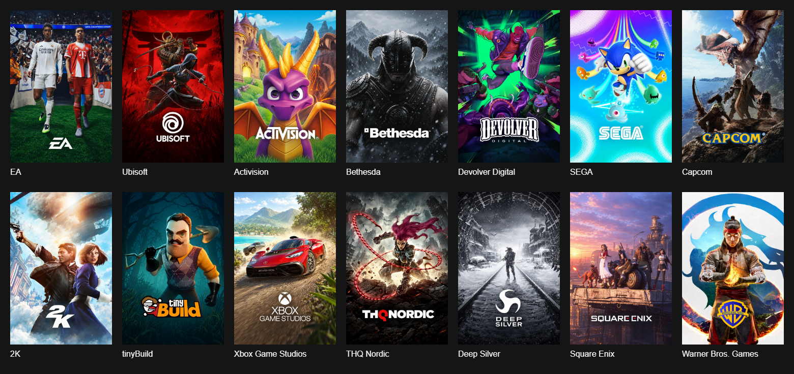
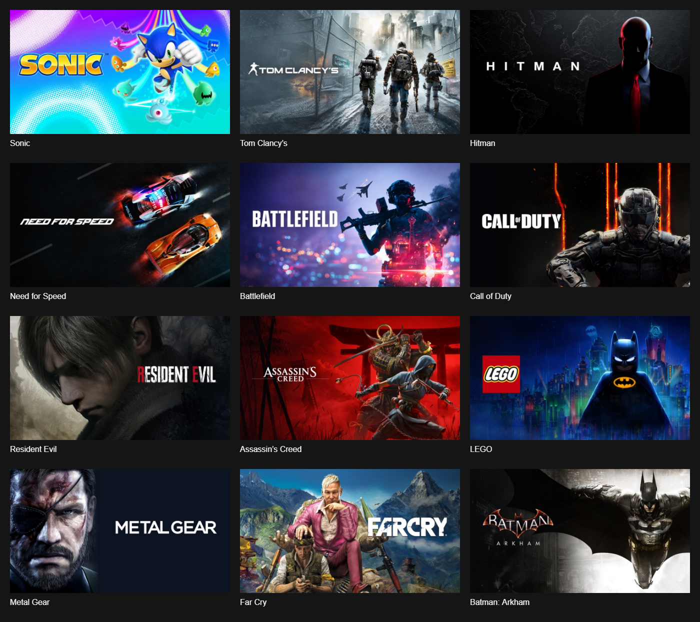

# Publisher and series artwork

The app bundles 14 publisher cards and 12 series banners as finished local JPEG assets, including their branding. It does not assemble game art and logos at runtime. Other collections retain a simple text fallback.

These unofficial collection designs use promotional campaign references, with restrained layouts and recognisable characters and materials. Eighteen images were edited with the built-in image generator. The remaining eight were composed directly from authentic campaign artwork and logo crops after generation was rejected. [The artwork record](../collection-artwork-prompts.json) includes each asset's method, prompt or composition recipe, source references, dimensions and bundled path.

## Publishers

## Series

Bundled assets are in `src/renderer/assets/collections/`, and the name-to-file mapping is in `src/renderer/collection-artwork.js`.
