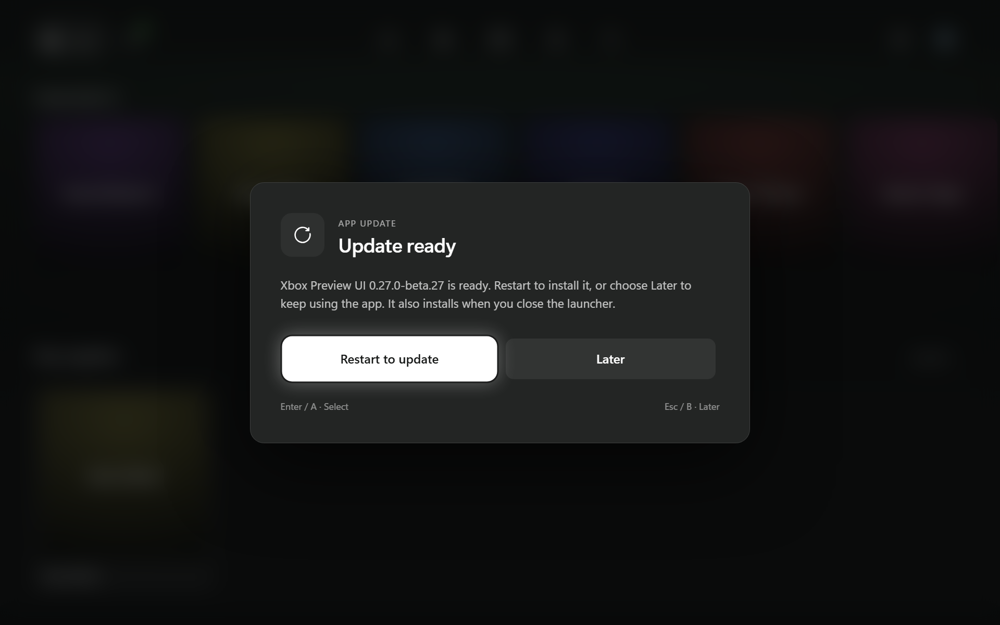

# 0.27.0-beta.27

The app checks for updates as soon as its window loads, replacing the previous 20-second delay. The check runs in the background and keeps the existing periodic checks, checksum verification and safe-mode behavior.

When an update is available, a centred dialog shows its download progress and a large **Continue in background** button. Once verified, the dialog offers **Restart to update** and **Later**. Keyboard Tab/arrow keys and controller navigation stay inside the prompt, Enter/A selects, and Escape/B dismisses it and restores focus. Download progress preserves the focused button. Dismissing a version keeps it quiet for the session; **Settings → Account → Check for updates** can reopen it.

Automatic prompts wait for the startup animation, onboarding, other dialogs, Store checkout, game launching and an active game to finish. Failed checks leave the app usable, and an installation error appears inside the prompt with a retry path.

Includes the [beta 26 fixes and all 26 publisher/series artwork cards](release-0.27.0-beta.26.md).

Validation: immediate startup checking and duplicate-schedule prevention; the existing real Windows update-helper, rollback and running-game checks; centred layout at 1920×1080, 1280×800 and 1024×640; keyboard/controller focus, mouse and Escape/Back dismissal, progress focus retention, manual checks, deferred prompts and install-error recovery. UI checks use mocked update IPC and do not install or restart the app.
