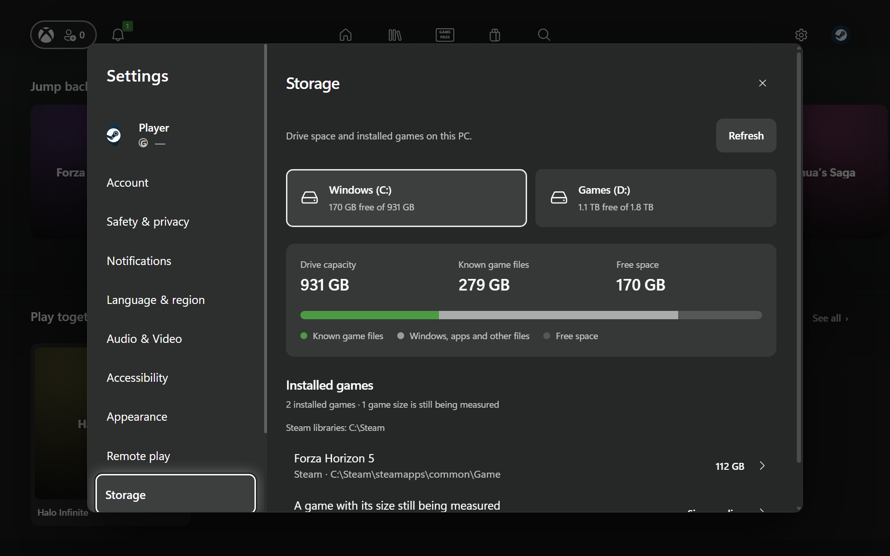
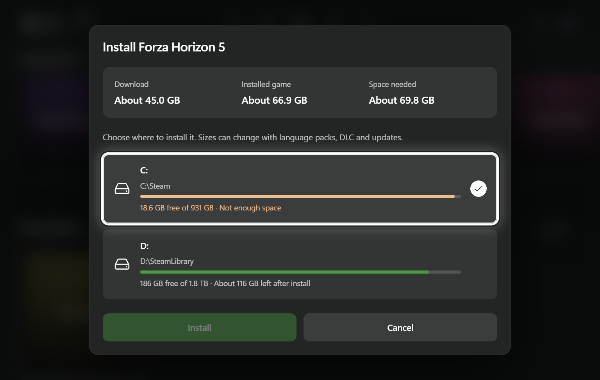

# Beta 29

Storage, remote play and Steam drive selection now follow the app's current console interface.

- New dialogs share the management screens' charcoal surface, typography, spacing, rounded controls and blurred backdrop.
- Remote PCs use the same settings cards and rows as the rest of Settings. Resolution, frame rate and bitrate open the existing controller-friendly choice dialog.
- Storage uses selected drive cards, a green space indicator, and the normal settings rows for installed games. Known sizes, pending sizes and empty drives stay clearly labelled.
- Install estimates sit together above the drive choices. Low-space warnings remain readable, and Install stays disabled when a drive cannot fit the game.
- Shared controls support larger text, and Settings stays inside the screen when UI scale is increased.

Captures use a sample library and drive sizes.

## Validation

- Reviewed storage, remote libraries, add-PC and PIN dialogs, and install sizing at 1920×1080, 1280×800 and 1024×640.
- Checked 130% text size with 125% UI scale, visible controller focus, scrolling to install actions, empty states and drive switching.
- Checked search, modal focus, quality selection, Back navigation, low-space prevention, delayed lookup cancellation and the remote launch/return flow.
- Rechecked existing library management, duplicate selection, Steam launch options and the centred update prompt.

Includes the features from [beta 28](release-0.27.0-beta.28.md). Remote play remains a preview: live gameplay against a paired host still needs verification, and game-ready/exit behaviour depends on the host's session tracking. See [remote play setup and limits](remote-play.md).
