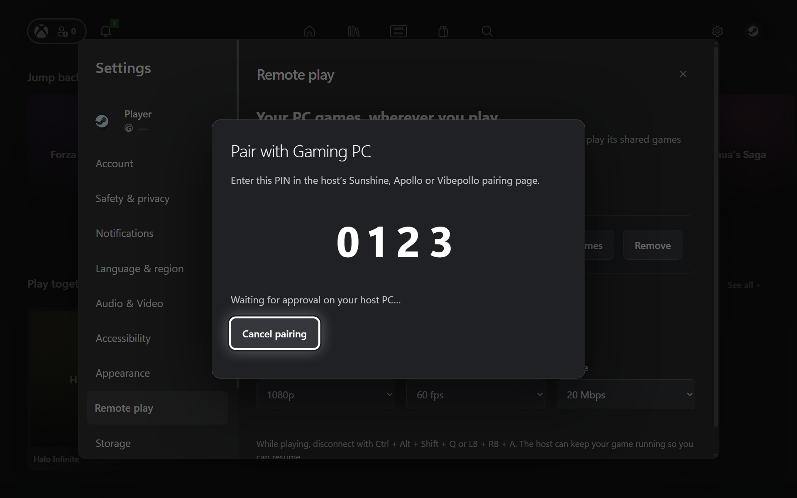

# Remote play preview

The app uses StreamLight's native streaming runtime with Sunshine, Apollo and Vibepollo hosts. StreamTweak is not required. Pairing, host libraries, search, launch progress and return navigation use the app's own interface. Only the native video surface is embedded in the launcher window; StreamLight's separate launcher interface stays hidden.

UI capture with a sample host and test PIN.

## Connect a PC

1. Run Sunshine, Apollo or Vibepollo on your gaming PC and publish the games you want to stream in its app list.
2. Open **Library → Remote PCs → Find a PC** (also available in Remote play settings). Nearby PCs are discovered automatically. Select a result, or use **Enter address manually** for a hostname, VPN address or custom HTTP port such as `192.168.1.20:48000`. The default port is 47989.
3. Enter the displayed four-digit PIN in the host's pairing page. The client waits for approval and saves the PC and its published games.
4. Return to **Library → Remote PCs** to see saved PCs, their connection status and square game cards. Selecting a game opens its normal game page; choose **Play remotely** to start it.
5. Open **Stream settings** from the selected PC or a remote game's options. Resolution, frame rate, bitrate, codec and decoder are saved separately for each PC. Defaults are 1080p, 60 fps and 20 Mbps; handheld 16:10 resolutions and 90/120 fps are also available. Audio layout, V-Sync, frame pacing, performance statistics, multiple controllers, face-button swaps, controller mouse mode, touch mode, mouse mode and the controller disconnect shortcut are also configurable. Changes apply to the next stream.

Both devices must be able to reach each other. Remote play does not open router ports or configure a VPN. A reachable VPN hostname/address can be entered like any other host address.

## Starting and ending a session

The existing game launch animation remains visible while the client connects. The native surface is revealed once the host reports the selected app running, the engine reports that its first decoded picture is ready to reveal, and Windows has attached the video window to the launcher. Video-format negotiation alone does not dismiss the animation. Controller navigation in the launcher is suspended during play. Connection failures show an error with retry and stream-settings actions.

When the host reports that app has stopped, the client ends its stream and returns to the game page. Back returns to the selected Library tile. Two successful state checks confirm the exit; a failed request is not treated as a closed game. A replacement app on the host also ends this client's stream without stopping the replacement app.

To disconnect manually, use the **Disconnect** button above the video, **Ctrl + Alt + Shift + Q**, or **LB + RB + A**, StreamLight's default controller shortcut. Hold the controller shortcut for half a second to also trigger the independent XInput escape path. Stream settings can change it to Moonlight's **View + Menu + LB + RB** combination. Swapping A/B changes the first shortcut's physical A button to B; the bar shows the active combination.

Choose **Hide** to dismiss the bar completely and return its space to the video. Hold **LB + RB + View** for half a second, or press **Ctrl + Alt + Shift + H**, to show or hide it again. The bar starts visible for each new stream. Disconnect shortcuts remain active when it is hidden; holding the show/hide shortcut toggles only once until released.

When visible, the control bar remains outside the native video surface and resizes with text scaling. **Ctrl + Alt + Shift + Z** releases a captured mouse so it can reach Disconnect or Hide; touch can use either button directly. The mouse-release and disconnect keyboard controls follow the [Moonlight setup guide](https://github.com/moonlight-stream/moonlight-docs/wiki/Setup-Guide). The native bridge registers its keyboard shortcuts while this stream has foreground focus, independently of the renderer and streaming engine's input handler. The controller show/hide shortcut uses XInput on Windows handhelds and Xbox-compatible pads.

Disconnecting the client does not send a host-game quit request, so a game can stay open for later resumption. Cancelling the launch animation also disconnects the client. Closing the launcher or its native bridge closes its owned streaming process.

The bundled engine receives background gamepad events because its native video window is embedded under Electron. This avoids SDL dropping controller input when the launcher owns the foreground window. StreamLight retains responsibility for device mapping, hotplug and input forwarding. Multiple controllers are enabled by default. Controller mouse mode can be toggled by holding Menu / Start, or disabled in Stream settings.

## Artwork

Remote cards use the same square tiles, cover fallbacks and optional logo overlays as local games. The client first reuses manual selections and artwork from its saved local library, cached Xbox catalog and available Steam discovery results. A known Steam identity takes priority; otherwise matching uses a conservative normalized title and never treats the host's opaque app ID as a Steam ID.

Missing artwork uses the app's normal Xbox, IGN, PlayStation, SteamGridDB and Steam lookup and image cache. Only when that produces no cover does the client use the host's published image. Full artwork metadata, including heroes and logos, is retained for game pages and the launch animation. Shared requests are coalesced across PCs, successful lookups are reused, and local artwork remains available when a host is offline.

## Keeping the game list accurate

Refreshing replaces the saved list with the host's current published apps, removes apps the host explicitly marks uninstalled, and refreshes artwork when its revision changes. Standard Sunshine/Apollo app lists do not include a complete installed-game inventory: a stale shortcut can still be published after its game is removed.

For Vibepollo's Steam integration, enable **Steam auto-sync → Remove uninstalled games** (`steam_autosync_remove_uninstalled = true`) and reload the host configuration. Its Playnite integration has a separate cleanup setting. For manually published Sunshine/Apollo games, remove obsolete shortcuts on the host. The client also offers **Hide from this library** and **Restore hidden games** without changing the host's configuration.

## Host behaviour and preview limits

- This browser shows the host's **published apps**, not an inventory of everything installed on its disk. Configure the host's game library or its existing library integration to publish additional games.
- The standard protocol exposes app/session state, not a universal game-window-ready signal. Some games can show a host desktop, splash screen or launcher after the stream becomes ready. Exact window detection cannot be guaranteed across unmodified Sunshine/Apollo/Vibepollo hosts.
- Automatic termination depends on the host tracking the actual game. Desktop sessions or detached launcher commands can remain active after the game exits. Configure those apps to track their game's lifetime, or disconnect manually.
- StreamLight's CLI selects apps by name. Give apps unique names on the host; ambiguous duplicates are reported before launch. Invisible ordering prefixes are retained for launching while labels are cleaned for display.
- A host already running a different app is left alone. Close that app before launching another game. Selecting the same running app resumes it.
- Cached libraries remain browsable while a PC is offline. Starting or refreshing needs a reachable, paired host. Artwork downloads are limited to cards as they become visible.
- This preview has automated UI, state, discovery, native-window and identity/TLS checks. The bundled engine's hidden-window launch path is tested against a local protocol fixture. Its actual SDL library is tested with virtual controllers for background buttons, sticks, triggers and hotplug. Native shortcut registration, dispatch, focus guards and controller hold timing are checked separately. Live gameplay against a paired gaming PC and physical controller/decoder combinations still need device verification. HDR, microphone passthrough, host power controls and mid-stream quality changes are not exposed in this preview.

## Pairing data

The app keeps an isolated StreamLight portable profile under its own user-data `remote-play/engine` directory. It does not reuse or change a separate StreamLight installation. Private client credentials stay in the main process; the renderer receives host names, library records and public artwork only. HTTPS requests verify the saved host certificate. If a host identity changes, remove the entry and pair again.

Removing a PC removes it from this app's browser. To revoke this client on the host as well, remove it from the host's paired devices. Re-adding the same PC can reuse its existing local pairing until it is revoked on the host.

## Streaming component and source

- Engine: [FoggyBytes/StreamLight, v7.0.0](https://github.com/FoggyBytes/StreamLight/tree/v7.0.0), using Moonlight's streaming core, FFmpeg, SDL and the upstream decoder/runtime dependencies.
- License: [GPL v3](../src/remote-play/LICENSE.StreamLight), also included next to the bundled runtime.
- Engine source: the linked release tag and its recorded submodules; the app does not modify StreamLight's binary or source.
- Integration source: [remote-play.cjs](../src/remote-play.cjs), [remote-artwork.cjs](../src/remote-artwork.cjs), [remote-discovery.cjs](../src/remote-discovery.cjs), [WindowBridge.cs](../src/remote-play/WindowBridge.cs), and [remote-play-ui.js](../src/renderer/remote-play-ui.js).
- Build preparation: run `npm run prepare:streaming` on Windows. [prepare-streaming.cjs](../scripts/prepare-streaming.cjs) verifies a pinned official installer, extracts its files without running setup, and compiles the native bridge using Windows' .NET Framework C# compiler. The unpacker is used only during preparation and is not bundled.
- Each build includes a `runtime-manifest.json` with the pinned engine source/version and hashes of its runtime files. Build staging and private pairing data are ignored by Git.

The native bridge uses a Windows job object to own the decoder process and a child window for its SDL surface. It follows the parent client's physical pixel dimensions and keeps the engine's other windows hidden. Temporary SDL decoder-probe windows are ignored. The isolated engine profile disables its Qt entrance animation so hidden UI cannot stall the launch request. This avoids moving decoded frames through JavaScript or Chromium's video pipeline.
